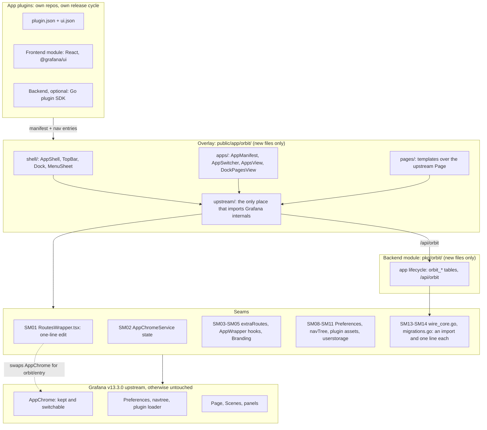
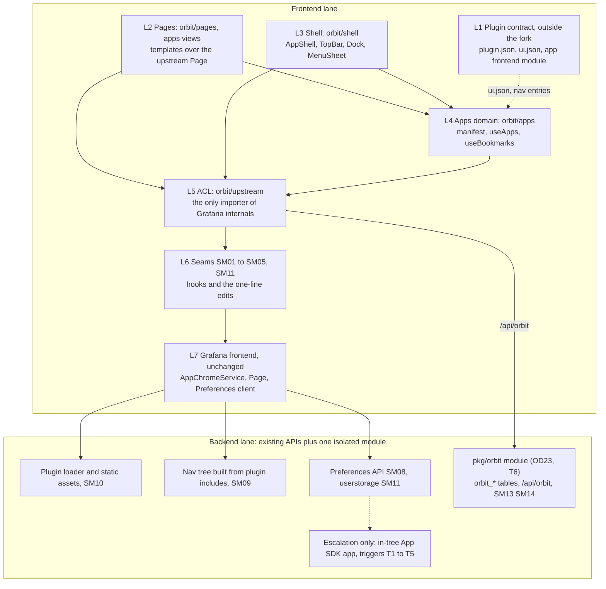
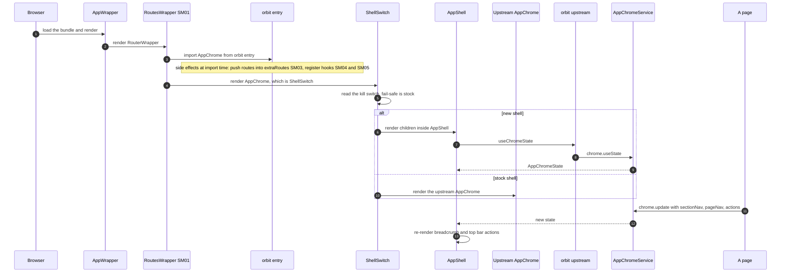
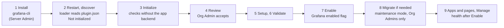
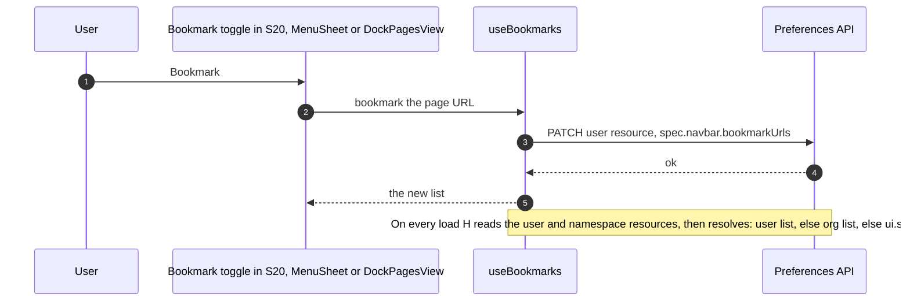
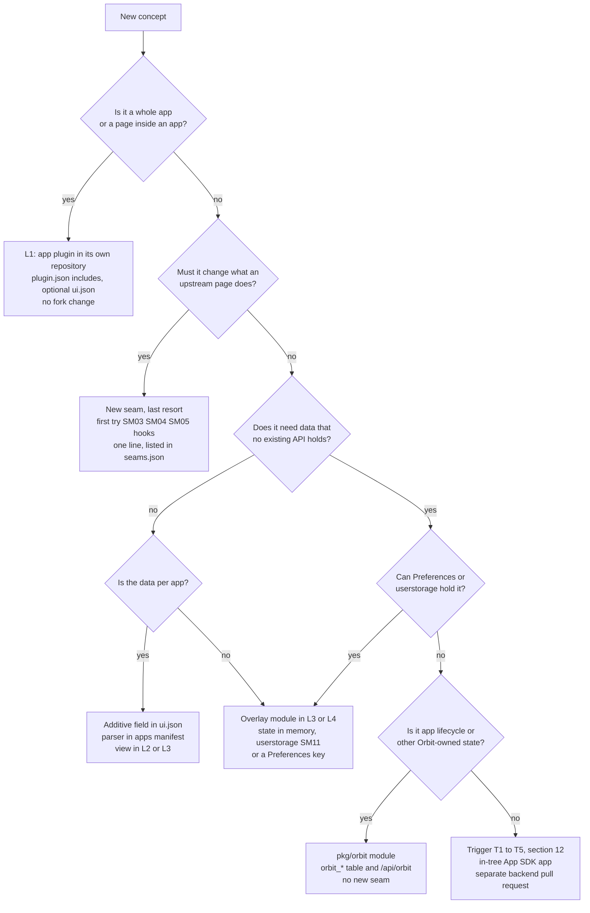

# Custom Grafana UI: Overlay Architecture, Upstream Sync and Apps

| | |
| --- | --- |
| Status | Draft for review, revision 2 (completeness audit applied, see section 17). No product code has been written. |
| Base | Grafana **v13.3.0** (tag). All `file:line` references are to that tag. |
| Compared against | upstream `main` at `578a5dbc8` (2026-11-03) |
| Owner | Amir |
| Format | English, Markdown |

**Evidence labels used throughout**

- **Verified**: I read the code at the cited location.
- **Inferred**: deduced from code that I read, but not executed.
- **Not verified**: unknown. The text says how to check it.
- **Proposed**: a design rule for code that does not exist yet.

**ID conventions**

Every ID is unique across the project (decided 2026-11-17). The design boards set the standard: a letter for the kind and two digits. Other kinds use their own prefix, so no ID can mean two things.

| Kind | IDs | Where |
| --- | --- | --- |
| Design boards | `R01`-`R11` reference, `S01`-`S21` screens (without `S05`, `S09` and `S17`), `P01`-`P07` page templates | design canvas, section 21 |
| Seams | `SM01`-`SM14` | section 6, `.orbit/seams.json` |
| Risks | `RK01`-`RK24` | section 15 |
| Open decisions | `OD1`-`OD35` (some withdrawn) | section 20 |
| Escalation triggers | `T1`-`T6` | section 12 |
| Layers | `L1`-`L7` | section 5.2 |

So `S11` is always the board DockPagesView, `SM11` is always the userstorage seam, `R10` is always the lifecycle reference board, and `RK10` is always the StrictMode risk. Until 2026-11-17 seams were `S1`-`S14` and risks `R1`-`R24` (revision note 80). Board R03 (section "IDs and tags") shows the same table on the canvas, together with the meaning of every tag chip used on the boards.

Nothing has been built, type-checked, linted or tested. `node_modules` is not installed in the research tree. Every "will work" below is a claim to confirm in the v0.1 spike (section 16).

---

## 1. Summary

1. **Overlay, not rewrite.** The new UI lives in `public/app/orbit/` as new files. Upstream frontend files are edited in exactly one place that is required (`RoutesWrapper.tsx`, one line, SM01) and one place that is optional (`i18next.config.ts`, one line, SM06). The backend module adds two small registrations of two lines each, an import and one call (SM13, SM14).
2. **View-swap behind a stable model.** Pages talk to the shell only through the `AppChromeService` state (`chrome.update(...)`). The new `AppShell` reads that same state, so every existing Grafana page keeps working without changes.
3. **Apps are app plugins** in their own repositories, using Grafana's existing plugin system. A sidecar file `ui.json` carries the UI-only metadata (accent, dock/menu defaults, page descriptions). Grafana's backend gets **one isolated module, `pkg/orbit`** (decided 2026-11-17, OD23): its own tables (`orbit_*`) and API (`/api/orbit/…`) for the app lifecycle, wired with two small registrations (SM13, SM14). Everything else uses existing Grafana APIs.
4. **Bookmarks** (shown in the dock for the active app and in the Bookmarks list) are stored in Preferences (`navbar.bookmarkUrls`): the organization default lives in the `namespace` resource and the per-user override in `user-<uid>`. The client resolves them (section 11).
5. **Upgrades follow every minor release tag** (13.4, 13.5, ...) with a patch-stack rebase. CI enforces three guards: a seam allow-list, import boundaries, and contract tests against the upstream shapes we depend on.
6. **Two things changed during review** (details in section 17): Grafana's lint rules ban `config.apps` and `config.featureToggles`, so app discovery and the kill switch use different mechanisms than first proposed.

Where to look:

- Layers and the design pattern of each layer: section 5.2.
- How it works at runtime (page load, the life of an app, bookmarking): section 5.3.
- How to add a new concept: section 5.4.
- What is still undecided: section 20. What each design board maps to: section 21.

## 2. Goals and constraints

Goals (from the request):

- Implement the new UI (floating Dock, MenuSheet, AppShell, apps model, DockPagesView, page templates) and the new "apps" and "pages" concepts.
- Respect Grafana's architecture, structure and design patterns, and split the work cleanly between frontend and backend.
- Keep it modular, maintainable and updatable.
- Reuse Grafana's own mechanisms (plugins and similar) before inventing new ones, and add new patterns only for new concepts.
- Make every decision so that the fork can keep pulling upstream Grafana with the fewest possible conflicts.

Constraints found in the code:

- A plugin **cannot** replace the chrome. The extension point `grafana/app/chrome/v1` renders only for the setup-guide plugin (`AppChromeExtensionPoint.tsx`, `renderLimitedComponents`), and `AppChromeService` re-derives `chromeless` from the current route on every update (`AppChromeService.tsx:108,116`). **Verified.**
- `<AppChrome>` has exactly one production consumer: `public/app/routes/RoutesWrapper.tsx:9`. The other consumers are test helpers (`features/scopes/tests/utils/render.tsx`, `features/explore/spec/helper/setup.tsx`). **Verified.**
- Repository rules (`AGENTS.md`): follow existing patterns, keep changes focused, separate frontend and backend pull requests, run `make gen-go` after DI changes.

## 3. Decisions

Four decisions were discussed and approved.

| ID | Decision | Rejected options | Main reason |
| --- | --- | --- | --- |
| D1 | **Overlay + view-swap** for the shell | (a) Edit `AppChrome.tsx` in place. (b) Plugin-only chrome. (c) CSS-only reskin. | (a) `AppChrome.tsx` had 25 commits in a year and 12 in the last 90 days, and `main` already differs from v13.3.0 by 9 lines. (b) Impossible, see section 2. (c) Cannot change structure (Dock, MenuSheet). |
| D2 | **Follow every minor release tag** with a patch-stack rebase (`git rebase --onto <new tag> <old tag> <branch>`) | (a) Track `main` continuously. (b) Follow only one release branch. | (a) `main` had about 12,000 commits in a year and 3,600 in the last 90 days, with no stable base to test against. (b) Falls behind on fixes. Tags are tested releases. |
| D3 | **Apps are app plugins outside the fork**: frontend module plus optional Go backend (plugin SDK). `ui.json` sidecar for UI metadata. Escalate to an in-tree App SDK app only on defined triggers (section 12). | (a) In-tree App SDK app from day one. (b) Apps inside `public/app/plugins`. | (a) Touches `wireset.go`, `apps.go`, regenerates `wire_gen.go` (205 commits in a year) and `go.work`, and couples app releases to backend deploys. (b) Edits the upstream tree. The plugin contract is the most stable public surface Grafana offers. |
| D4 | **Dock/menu ownership: organization default plus user override**, stored in Preferences `navbar.bookmarkUrls` | (a) Browser `localStorage` only. (b) User-only. (c) A new backend table. | (a) Per browser, not shared (the stock "customise" flow does this for hidden items). (b) No org default. (c) A backend change. |

Defaults that are cheap to change later:

- Custom code lives in `public/app/orbit/`. Its entry point is reached from the SM01 seam, **not** from the Enterprise loader in `app.ts`, because that loader differs between v13.3.0 and `main` (section 7).
- Generated files are never edited by hand (`featuremgmt/registry.go`, `public/locales/en-US/grafana.json`, `pkg/server/wire_gen.go` except by regeneration).
- The stock `AppChrome` stays bundled and switchable until v1 is declared stable. The switching mechanism changed in review (section 9.4).
- The UI is English only, no RTL. Strings still go through `t()` with English defaults, because the lint rules require it (section 14).
- AGPL obligations are flagged in section 15. This is not legal advice.

## 4. Principles and design patterns

Principles:

- **Smallest upstream surface.** Every upstream file we edit is a recurring conflict. The target is one required edit.
- **One-way dependency.** `orbit/` depends on Grafana. Grafana never depends on `orbit/`, except through the SM01 import.
- **Deletable.** Delete everything named `orbit` (`.orbit/`, `public/app/orbit/`, `pkg/orbit/`, `.claude/skills/orbit-*`) and revert the seam commits, and you have stock Grafana again (section 13.4). This is a testable property and a CI check.
- **Data over code.** Per-app UI behaviour is a manifest (`ui.json`), not code in the fork.
- **Fail soft.** A missing or invalid manifest degrades to defaults and logs a warning. It never breaks the page.
- **Say what is verified.** Docs, PRs and commit messages carry the evidence labels.
- **Grafana's design language first (decided 2026-11-17, owner).** The current designs stay as they are. Every new layout and component starts from Grafana UI (`@grafana/ui`) and its design principles, and our own UI language (dock, MenuSheet, app tiles, lifecycle colours, button zones) is built on top of it, not beside it. See section 4.1.

### 4.1 UI reference: Grafana UI Storybook (decided 2026-11-17)

**Reference:** https://developers.grafana.com/ui/latest/index.html?path=/docs/docs-overview-intro--docs

This is Grafana's own catalogue of `@grafana/ui` components, with a live preview, the props and usage notes for each. The `@grafana/ui` README points to it ("Browse the Storybook catalog of the components", http://developers.grafana.com/). It shows the latest release, which can be newer than v13.3.0: before using a component, check that it exists with the same props in the v13.3.0 source.

How we use it:

1. **Before designing something new,** look for a Grafana component that already does the job (for example `Button`, `IconButton`, `Combobox`, `FilterInput`, `Toggletip`, `Drawer`, `Modal`, `TabsBar`, `Card`, `Badge`, `Icon`, `EmptyState`) and preview it in the Storybook. Use it as it is.
2. **If we need a variant,** compose it from Grafana components and theme tokens (`theme.spacing`, `theme.shape`, `theme.colors`, `theme.typography`) instead of copying or restyling the component.
3. **Only if nothing fits,** design a new component. It uses the same tokens, sizes, focus ring and states as the nearest Grafana component, and its board names that component as its base (as R04-R11 already do with their "Grafana" and "Custom" labels).
4. **Placement** follows Grafana's layouts and our button zones (section 10.11); **icons** follow section 10.12.
5. **When a new board is drawn,** note on it which Storybook entry it was checked against.


Patterns, with the problem each one removes:

| Pattern | Where it is used | What it protects against |
| --- | --- | --- |
| **Overlay + view-swap behind a stable model** | `AppShell` replaces the `AppChrome` view; `AppChromeService` stays the model | Rewriting or copying upstream chrome logic |
| **Composition over copy** | Reuse upstream `Page`, `CommandPalette`, `ExtensionSidebar` and similar instead of cloning them | Silent divergence from upstream fixes |
| **Anti-Corruption Layer** (`orbit/upstream/`) | Every import of Grafana internals, plus contract tests | An upstream rename or reshape breaking many files at once |
| **Seam registry + drift guard** | `.orbit/seams.json` allow-list checked in CI | Accidental edits to upstream files |
| **Patch-stack rebase per tag** (`git rerere`) | Branch model, section 13 | Merge storms; repeated manual conflict resolution |
| **Manifest sidecar** | `ui.json` next to `plugin.json` | `plugin.json` fields that Grafana's loader drops (section 10) |
| **Kill switch with fail-safe default** | `ShellSwitch` | Shipping an unrecoverable broken shell |
| **Strangler** | Stock chrome stays reachable until v1 is stable | Big-bang cutover |

## 5. Architecture overview

### 5.1 Overview



Reading the diagram:

- Everything new sits in the overlay. App plugins are separate products that talk to Grafana through the normal plugin contract.
- All traffic from the overlay to Grafana passes the ACL and then one of the numbered seams (section 6).
- The only frontend upstream edit that changes behaviour is SM01. SM13 and SM14 only register the backend module `pkg/orbit`, which the overlay reaches through the ACL and `/api/orbit`.

### 5.2 Layers and patterns

The overlay has seven layers. The names L1 to L7 are labels used in this document only; folders are defined in section 8. A layer may use only the layers below it in the diagram (arrows), and only L5 touches Grafana internals.



| Layer | Where | Responsibility | Patterns used | May import | Backend counterpart |
| --- | --- | --- | --- | --- | --- |
| **L1 Plugin contract** | Separate app repositories | Ship an app: `plugin.json` with `includes[]`, `ui.json`, frontend module, optional Go backend | Plugin (Grafana's own mechanism); manifest sidecar; data over code; fail soft | Public `@grafana/*` packages only | Go plugin SDK in the app repository. Grafana's loader reads `plugin.json`; the static route serves `ui.json` (SM10) |
| **L2 Pages** | `orbit/pages/`, `orbit/apps/AppsView.tsx`, `DockPagesView.tsx` | Page templates P01-P07 and the new routes | Composition over copy (wrap the upstream `Page`); template per layout; strangler (core pages adopt templates one by one) | L4, `theme/`, `upstream/page.ts` | None in v1 |
| **L3 Shell** | `orbit/shell/` | Frame, top bar, dock, menu sheet, switchers | View-swap behind a stable model; observer (reads `chrome.useState()`); kill switch with fail-safe default | L4, `theme/`, `upstream/chrome.ts` | None in v1 |
| **L4 Apps domain** | `orbit/apps/` (non-view code), `apps/manifest/` | App registry, manifest parsing, bookmark resolution, active app | Adapter and resolver (user, then org, then computed); null object (defaults on failure); parse, don't cast (lint bans `as`); one place for each rule | `upstream/*` | Reads the existing nav tree, Preferences and plugin asset endpoints; reads and writes the app lifecycle through `/api/orbit/…` (`pkg/orbit`, OD23) |
| **L5 ACL** | `orbit/upstream/` | Small, stable functions and hooks named after what we need | Anti-Corruption Layer (facade); one contract test per function | Grafana internals | The HTTP and API shapes consumed here |
| **L6 Seams** | SM01-SM14 in section 6; `.orbit/seams.json` | The only points where the overlay meets Grafana | Hook registration (Grafana's own `extraRoutes`, `addEnterpriseProviders`, ...); seam registry with drift guard; patch stack | n/a | SM08-SM12 are existing server features used as they are; SM13 and SM14 register `pkg/orbit` |
| **L7 Grafana** | `public/app/**`, `pkg/**` | Everything else | Unchanged. We follow it, we do not edit it. | n/a | Nav tree, Preferences, plugin loader; unchanged except the SM13 and SM14 lines |

Rules that keep the layers honest (checked by `.orbit/scripts/check-boundaries.mjs`, section 8):

1. Imports go downward only. L2 and L3 do not import each other; L4 does not import L2 or L3.
2. Only L5 imports Grafana internals. A Grafana rename changes one file in L5 and one contract test.
3. Every rule about data (bookmark resolution, manifest defaults, active app) lives in L4 once. Views never re-implement it.
4. Views are dumb. They get data from hooks in L4 and render with `@grafana/ui` and theme tokens.
5. Anything new that talks to the backend goes through L5 and uses an existing API, or `/api/orbit/…` for state that Orbit owns (the app lifecycle). If neither fits, that is an escalation trigger (section 12), not a reason to add a call from a view.

### 5.3 How it works at runtime

**A. From page load to a rendered page.** Steps 3 and 4 depend on SM01 (Inferred until the v0.1 spike). The other steps read existing Grafana code (Verified: `AppWrapper.tsx:30,154` imports and renders `RouterWrapper`; `RoutesWrapper.tsx:9,35,47` use `AppChrome`; `Page.tsx:49` calls `chrome.update`).



What this shows:

- **Pages do not know which shell is active.** They write to `AppChromeService`; the active shell reads it. That is why the swap needs no page changes.
- **The kill switch sits in front of everything new.** If it cannot be read, the stock `AppChrome` renders.
- **Route registration is a side effect of the SM01 import.** `getAppRoutes()` is read at render (`AppWrapper.tsx:108`), so routes pushed earlier are visible (Inferred).

**B. The life of an app** (section 10.9, decided 2026-11-16 and 2026-11-17). Install and restart are Grafana's; every step after that is the apps module (`orbit/apps/lifecycle` in the frontend, `pkg/orbit` in the backend).



- State of each step lives in `orbit_app_lifecycle` (per organisation); Enabled is Grafana's own `enabled` plugin setting (OD23).
- Grafana answers the app backend (health, resources) only for an enabled app (`api.go:437-439`), so health and backend self-tests run after Enable, and migrations run after Enable in maintenance mode (OD28).
- After an update (OD31) the module compares the loaded version with its stored copy, at start-up and on read, and reopens only the steps that need an admin (S21).

**C. Bookmarking a page (shown in the dock).** The read side resolves in the client (section 11); only the write is a server call.



### 5.4 Adding a new concept

A "concept" is anything new that the product should have: an app, a page, a shell feature, a metadata field, a setting, a rule. Decide where it lives before writing code.



| Kind of concept | Lives in | Data lives in | Upstream edits | Backend change | Example |
| --- | --- | --- | --- | --- | --- |
| New app | Own plugin repository (L1) | `plugin.json`, `ui.json` | none | none (optional plugin backend in its own repository) | A maintenance app |
| New page in an app | Same plugin | `includes[]`, `ui.pages` | none | none | A work-orders page |
| New shell feature, UI only | `orbit/shell`, `orbit/apps` | Memory or chrome state | none | none | A keyboard-hint overlay |
| New per-app UI metadata | Manifest parser plus a view | `ui.json` (additive field) | none | none | `shortcuts` (example A) |
| New per-user UI setting | A hook in `orbit/apps` | userstorage (SM11) or a Preferences key | none | none | Dock position |
| State the server must keep for Orbit (app lifecycle) | `pkg/orbit` module | An `orbit_*` table, `/api/orbit/…` | none beyond SM13, SM14 | **yes**, separate pull request | Review acceptance, last accepted version |
| Org-wide rule enforced by the server | In-tree App SDK app | A new resource | Registration files (section 12) | **yes**, separate pull request | Locked org dock (example B) |
| New behaviour inside an upstream page | A new seam | n/a | **yes**, one line, justified in `.orbit/seams.json` | none | Last resort |

**Procedure** (the same for every concept):

1. **Classify** with the diagram above, and write five lines in the pull request: the concept, the layer, where the data lives, which seams it touches, and how it is deleted.
2. **Name the contract first.** If it reads Grafana state, add a function in `orbit/upstream/` and a contract test before any view code.
3. **Define the data shape.** Types plus a hand-written parser (no `as`, no `any`). Invalid input yields defaults and one warning.
4. **Build bottom-up:** hook in L4, then view in L2 or L3, composed from `@grafana/ui` and theme tokens. Strings through `t()`. StrictMode-safe effects.
5. **Register through an existing seam.** If no seam fits, add a new one, update `.orbit/seams.json` with `maxChangedLines`, and justify it in the pull request. This is the only step that adds upstream conflict surface.
6. **Test:** contract test for the ACL function, unit test for the parser and resolver, component test (in `StrictMode`), selectors in `orbit/`.
7. **Run the guards:** seam allow-list, import boundaries, deletable check, lint, typecheck, Jest (section 13.3).
8. **Update the docs:** the traceability table (section 21), the seam table if it changed, the changelog entry.

**Example A: show an app's shortcuts in the Add menu.** Illustrative, not in the design. Zero upstream edits.

| Step | Change | Layer |
| --- | --- | --- |
| Data | Optional `shortcuts: [{ "label", "path" }]` in `ui.json`. Additive, so `schemaVersion` stays 1 (unknown keys are already ignored by older loaders). | L1 |
| Parser | `apps/manifest/`: validate label and a same-app `path`, cap the list length, drop invalid entries | L4 |
| Domain | `useApps()` returns `shortcuts` per app | L4 |
| View | `shell/add-menu/` renders one group per app that has shortcuts, using menu items and `TextLink` | L3 |
| Seams | none; `seams.json` unchanged | n/a |
| Tests | Parser unit test, Add menu component test | n/a |

**Example B: an admin locks the organization dock.** Illustrative. This hits trigger **T3** (section 12): Preferences cannot enforce it, because the stock write path lets any user patch their own `user-<uid>` resource.

| Step | Change | Layer |
| --- | --- | --- |
| Backend | A new `apps/<name>` App SDK app with a dock-policy resource and authorization, registered through `wireset.go` and `apps.go`, then `make gen-go` | Backend, separate pull request |
| ACL | `upstream/policy.ts` reads the new resource; contract test | L5 |
| Domain | `useBookmarks` consults the policy first: if locked, ignore the user list | L4 |
| View | Dock hides the bookmark controls when locked | L3 |
| Seams | none in the frontend | n/a |
| Docs | Record the trigger and its cost in section 12 | n/a |

## 6. Seam registry

A seam is any point where the overlay touches Grafana. There are fourteen. Three are required edits of upstream files: SM01 (frontend, one line) and SM13 and SM14 (the `pkg/orbit` backend module, OD23; an import and one line each). SM06 is an optional one-line edit. The rest use hooks or APIs that Grafana already exposes.

Columns: **churn** is the number of commits that touched that file on `main` (last year / last 90 days).

| ID | Seam | Location in v13.3.0 | Kind | Churn | Status |
| --- | --- | --- | --- | --- | --- |
| SM01 | Replace `AppChrome` | `public/app/routes/RoutesWrapper.tsx:9` (import), `:35` and `:47` (JSX) | **edit**, one line | 4 / 1 | Verified |
| SM02 | State contract between pages and shell | `AppChromeService.tsx:108,116` (`update`); `Page.tsx:49` | internal API, no edit | 13 / 4 | Verified |
| SM03 | `extraRoutes` | `routes.tsx:47` (array), `:678` (spread); read at render in `AppWrapper.tsx:108` | official hook | 33 / 9 | Verified |
| SM04 | `addEnterpriseProviders`, `addBodyRenderHook`, `addPageBanner` | `AppWrapper.tsx:49,53,57` | official hook | 15 / 3 | Verified |
| SM05 | `Branding` | `core/components/Branding/Branding.tsx:145` | official hook | 8 / 1 | Verified that the class exists; fields not reviewed |
| SM06 | Exclude `orbit/` from i18n extraction | `i18next.config.ts:8` | **edit**, optional, one line | 8 / 0 | Verified |
| SM07 | Kill-switch input | see section 9.4 | config | not measured | Revised in review |
| SM08 | Bookmarks in Preferences `navbar.bookmarkUrls` | `apps/preferences/kinds/preferences.cue:9`; stock read and write `MegaMenu/hooks.ts:38-48,121-124`; resource names `preferences/utils/names.go:12-46` | data, existing API | 3 / 0 (`model.go`) | Verified for stock read and write; org-level write **Not verified** |
| SM09 | Nav tree and app plugin metadata | `navtreeimpl/navtree.go:84` (`GetNavTree`), `applinks.go:168` (`processAppPlugin`); frontend `getAppPluginMetas` from `@grafana/runtime/internal` | data, read only | 40 / 15 (`navtree.go`) | Verified |
| SM10 | Sidecar `ui.json` | `pkg/api/api.go:265` (`/public/plugins/:pluginId/*` to `getPluginAssets`) | existing endpoint | not measured | Verified for the endpoint; signed plugins **Not verified** |
| SM11 | Optional per-user key-value store | `userstorage.grafana.app`; `packages/grafana-runtime/src/utils/userStorage.tsx` | existing API | not measured | Verified |
| SM12 | `AddIndexDataHook` (reserved for later) | `pkg/services/hooks/hooks.go:18` | backend hook | 1 / 0 | Verified; unused in v1 |
| SM13 | Register the `pkg/orbit` service | an import and one provider line, `orbit.ProvideService,`, in `pkg/server/wire_core.go` (the list where, for example, `queryhistory.ProvideService` sits at `:260`); `pkg/server/wire_gen.go` is regenerated with `make gen-go`, never edited by hand | **edit**, import plus one line | not measured | Pattern Verified; our line Proposed |
| SM14 | Register the `orbit_*` table migrations | an import and one line, `orbitmigrations.AddMigration(mg)`, in `pkg/services/sqlstore/migrations/migrations.go` (as `anonservice.AddMigration(mg)` at `:102`). The import is `pkg/orbit/migrations`, a leaf package that imports only `migrator`, as Grafana's own `migrations/anonservice` does; anything more would be an import cycle, because `sqlstore` imports `migrations` (`sqlstore.go:30`) | **edit**, import plus one line | not measured | Pattern Verified; our line Proposed |

Notes:

- **SM01, proposed edit.** Change the import on line 9 so that the name `AppChrome` comes from a module in `orbit/` (for example `../orbit/entry`). The JSX on lines 35 and 47 and the rest of the file stay untouched. `orbit/entry` runs registration (routes, hooks) as a side effect and exports `AppChrome`, which renders either the new `AppShell` or the upstream `AppChrome`. This has not been built (Inferred).
- **SM03 timing.** `getAppRoutes()` is called while rendering (`AppWrapper.tsx:108`), so routes pushed into `extraRoutes` at module-import time are present. Because `orbit/entry` is imported from SM01, it runs before the first render. Inferred. The v0.1 spike confirms it, including the absence of an import cycle through `routes.tsx`.
- **SM06 is optional but recommended.** `eslint.config.js:456-475` (pattern `public/app/!(plugins)/**`) makes `@grafana/i18n/no-untranslated-strings` an error for files in `public/app/orbit/`. Whether the `basePaths` option narrows that rule was not reviewed (Inferred). Using `t()` is therefore required, and without the ignore line `make i18n-extract` copies our keys into `public/locales/en-US/grafana.json`, a file with 1,085 commits in a year.
- **SM13 and SM14 follow Grafana's own pattern** (Verified on query history): a service takes `routing.RouteRegister` in its `ProvideService` and registers its own API endpoints (`pkg/services/queryhistory/queryhistory.go:17-35`, `api.go:17`), so no route file is edited; its provider is listed once in `wire_core.go`, and its tables are added by one `AddMigration` line from a leaf package (`migrations/anonservice/migrations.go` imports only `migrator`).
- Every edit row is recorded in the allow-list `.orbit/seams.json`, and CI rejects any other modified upstream file (section 13).

## 7. Dry run against `main`

Method: for each seam file and for the files the shell must mirror, compare `git show main:<path>` (clone at `578a5dbc8`, 2026-11-03) with the same file in the v13.3.0 worktree, counting differing lines.

Result: of 24 files, **16 are identical** (including both edit seams, `RoutesWrapper.tsx` and `i18next.config.ts`) and **8 differ**. None of the 8 is a file we edit.

Identical: `RoutesWrapper.tsx`, `routes.tsx`, `AppChromeService.tsx`, `AppChromeExtensionPoint.tsx`, `Page.tsx`, `Branding.tsx`, `i18next.config.ts`, `MegaMenu/hooks.ts`, `features/plugins/extensions/registry/setup.ts`, `pkg/services/hooks/hooks.go`, `pkg/plugins/plugins.go`, `preference/model.go`, `prefimpl/pref.go`, `featuremgmt/service.go`, `userStorage.tsx`, `preferences.cue`.

| File | Diff (lines) | What changed on `main` | Consequence for us |
| --- | --- | --- | --- |
| `public/app/AppWrapper.tsx` | 74 | The render tree is wrapped in `<StrictMode>` (`:136,172`). The three hook exports (`:49,53,57`) are unchanged. | Custom code must be StrictMode-safe: effects idempotent and cleaned up. |
| `public/app/core/components/AppChrome/AppChrome.tsx` | 9 | New flag `useFlagGrafanaScopesDashboardsMegaMenu`, new `AutoOpenMegaMenuForScopedContent`, changed scopes-drawer conditions. | The shell must mirror chrome behaviour that drifts. This is the "parity watch" (section 13). |
| `public/app/app.ts` | 12 | The Enterprise loader changed (next paragraph). Other lines are unrelated. | Do not depend on that loader. |
| `pkg/services/navtree/navtreeimpl/applinks.go` | 96 | `processAppPlugin` refactor: pages relocated by `navigationAppPathConfig` are placed by a deferred `addStandalonePage`; `pathConfig.Text` can override a title. | The nav tree for apps can change shape between releases even though we do not own that code. Contract tests on the nav tree JSON (section 14). |
| `pkg/services/navtree/navtreeimpl/navtree.go` | 3 | `publicdashboards.Enabled(...)` replaces `cfg.PublicDashboardsEnabled`. | None. |
| `pkg/api/api.go` | 3 | A `registerSwaggerUI` block that exists in v13.3.0 is absent on `main`. The route at `:265` is unchanged. | None. |
| `eslint.config.js` | 7 | Config loading and import settings. The i18n override block we rely on is unchanged. | None. |
| `packages/grafana-data/src/types/pluginExtensions.ts` | 1 | One enum member (`HomepageTabs`) differs. | Not reviewed further. |

The Enterprise loader in `app.ts`:

- v13.3.0: `require.context('.', true, /extensions\/index.ts/)` (recursive, unanchored).
- `main`: `require.context('./extensions', false, /^\.\/index\.ts$/)` (strict).

A path like `orbit/extensions/index.ts` works on v13.3.0 and breaks on `main`. The only path valid on both is `public/app/extensions/index.ts`, which is gitignored upstream and reserved for the Enterprise overlay. Hence the decision to reach custom code through SM01.

Limits of this dry run: it compares text only. `main` is not a release, no build was run on either side, and the churn numbers are for `main` (tags may differ).

## 8. Source layout and dependency rules

```text
public/app/orbit/
  README.md                 contract, seam registry pointer, upgrade notes
  entry.ts                  reached from SM01; registers routes and hooks; exports AppChrome (ShellSwitch)
  upstream/                 Anti-Corruption Layer: the only place that imports Grafana internals
    chrome.ts               useChromeState(), selectors over AppChromeState
    nav.ts                  nav tree access
    prefs.ts                Preferences client (bookmarks)
    plugins.ts              app plugin metadata, plugin asset fetch
    flags.ts                kill-switch input (section 9.4)
    page.ts                 re-export of the upstream Page
  shell/
    ShellSwitch.tsx         kill switch: AppShell or upstream AppChrome
    AppShell.tsx  TopBar.tsx  Clock.tsx  UserAvatar.tsx  AppBreadcrumb.tsx
    dock/  menu-sheet/  app-switcher/  user-menu/  add-menu/
    dock/BookmarkPopover.tsx  add-bookmark popover of the dock "+" slot (S20); uses useBookmarks
  apps/
    manifest/               AppManifest types, ui.json loader and validator, defaults
    useApps.ts  useBookmarks.ts  useActiveApp.ts
    nest.ts                 nests app includes by path into pages and sub pages when grafana.pluginPathNesting is off (section 10.10, OD22)
    bookmarks/              details.ts (user storage orbit-bookmarks: dock, label, showName, added, source); DockPagesView is mounted at /bookmarks
    builtin.ts              built-in app descriptors: Grafana's own sections as apps (section 10.5)
    AppsView.tsx  DockPagesView.tsx
    AppManageView.tsx  AppLifecycleView.tsx   manage one app; take an app from Not initialized to Enabled (sections 10.8, 10.9)
    CardToggle.tsx          icon-only bookmark toggle on DockPagesView cards (app cards use AppStatus, not a toggle)
    check/                  checks list: initialization, validation, health and page checks; definitions, runner, result types (no React)
    lifecycle/              status model (13 statuses, gates, buttons per status), AppStatus icon and chip, step list (section 10.9)
    updates/                AppVersionInfo block; version and compatibility logic (no React in the logic)
  pages/                    page templates P01-P07 composed over the upstream Page
  theme/                    design tokens, per-app CSS variables derived from `accent` (--hac, --hbg, --htx; bookmarks group --mac, --mbg, --mbd, --mhv)
  routes.ts                 pushes route descriptors into extraRoutes
  __tests__/contract/       contract tests: the shapes we depend on from upstream
.orbit/
  AGENTS.md, CLAUDE.md      agent guide for this folder (CLAUDE.md holds @AGENTS.md)
  VERSION, CHANGELOG.md, COMPAT.md   Orbit API version, release history, compatibility (13.5)
  seams.json                allow-list of edited upstream files, with maximum diff size
  scripts/                  agent-guard.mjs (Claude Code hook) and its test, session-start.mjs,
                            check-seams.mjs, check-boundaries.mjs, check-namespace.mjs, check-title.mjs
  docs/                     ARCHITECTURE.md (this file), HANDOFF.md, INIT-PROMPT.md, GITHUB-SETUP.md
  design/                   project/ (36 boards + canvas.json), pre_lifecycle/ (builder base files), tools/ (builders)
  map/                      architecture map builder and page
  published/                exact copies of the live claude.ai artifacts; artifacts.json indexes them
.claude/rules/orbit-*.md     rules every agent session loads; .claude/skills/orbit-*/ procedures; .claude/settings.json hooks
.github/workflows/orbit-*.yml  CI: checks on pull requests, release images, weekly upstream watch
```

Dependency rules (enforced by `.orbit/scripts/check-boundaries.mjs`, not by editing `eslint.config.js`):

1. Code in `shell/`, `apps/`, `pages/`, `theme/` may import only: other `orbit/` modules, `orbit/upstream/`, and public npm packages (`react`, `@emotion/css`, `@grafana/ui`, `@grafana/data`, `@grafana/runtime`, `@grafana/i18n`).
2. Only `orbit/upstream/` may import anything else from the Grafana tree (`app/core/...`, `app/features/...`, `app/types/...`, `@grafana/runtime/internal`).
3. Nothing outside `orbit/` imports from it, except the SM01 line.
4. `orbit/upstream/` exports small, stable functions and hooks named after what we need, not after how Grafana implements it.
5. Imports go downward (section 5.2): `pages/` and `shell/` do not import each other, and non-view code in `apps/` does not import `shell/` or `pages/`.

A check script is used because the repository's `eslint.config.js` is an upstream file; adding `no-restricted-imports` rules there would be a second edit (churn unknown) for no extra safety.

## 9. The shell

### 9.1 Contract

`AppShell` is a **reader** of the chrome state and a **host** for children. It does not call `chrome.update(...)`; pages do that (`Page.tsx:49`). It reads the state through `orbit/upstream/chrome.ts`, which wraps what `AppChrome.tsx:44,58` does today (`useGrafana().chrome`, `chrome.useState()`).

State fields the shell must honor (**Verified**, from `AppChromeState`): `chromeless`, `sectionNav`, `pageNav`, `actions`, `breadcrumbActions`, `megaMenuOpen`, `megaMenuDocked`, `kioskMode`, `fullscreenWorkspace`, `layout`, `returnToPrevious`.

Mapping of the new UI onto that state:

| New UI element | Reads from state | Notes |
| --- | --- | --- |
| `AppBreadcrumb` | `sectionNav`, `pageNav` | same inputs as the stock top bar |
| `TopBar` right side | `actions`, `breadcrumbActions` | pages already register these |
| `MenuSheet` open/closed | `megaMenuOpen` | `chrome.setMegaMenuOpen` keeps working for existing callers (Inferred) |
| Children only, no frame | `chromeless`, `kioskMode` | same as stock |
| Return banner | `returnToPrevious` | reuse the upstream component |
| Active app (chip, accent, breadcrumb) | not a field of `AppChromeState` | `useActiveApp()` derives it from the URL (`/a/<pluginId>/...`) or from the root of `sectionNav` for built-in sections (Inferred) |

The top bar has more parts than `actions` and `breadcrumbActions`; section 9.2.1 lists them.

### 9.2 Parity checklist

The stock `AppChrome.tsx` does more than draw a frame. A custom shell must mirror each behaviour or consciously drop it. Decisions are **proposed** and are confirmed in v0.2 by re-reading `AppChrome.tsx` at the then-current tag. Line numbers are v13.3.0.

| Stock behaviour | Location | Proposed v1 decision |
| --- | --- | --- |
| Skip link to `#pageContent` | `AppChrome.tsx:159-166` | **Mirror** (accessibility) |
| Main region `id="pageContent"`, `tabIndex=-1` | `:207` | **Mirror** (skip-link target; tests may select it) |
| Docked MegaMenu and `useResponsiveDockedMegaMenu` | `:96,169` | **Replace** with Dock + MenuSheet |
| `SingleTopBar` with `actions`, `breadcrumbActions` | `:172` | **Replace** with `TopBar` |
| `ScopesDashboards` drawer | `:17,194` | **Reuse** the upstream component (behaviour is drifting on `main`) |
| `ExtensionSidebar` (docked or floating, resizable) | `:22-24,225` | **Reuse** the upstream component inside the new layout |
| Lazy `CommandPalette` | `:37-38` | **Reuse** (lazy import through the ACL) |
| `SplashScreenModal` behind flag `splashScreen` | `:14,60` | **Reuse** (the design lists it as kept unchanged, R01) |
| `LazyFeatureControlFloating` (developer feature control) | `:25` | **Reuse** in development builds |
| `ReturnToPrevious` | `:31,111-116` | **Reuse** |
| `ErrorBoundaryAlert` around the scopes drawer | `:193` | **Reuse** with the drawer (kept in R01) |
| Kiosk mode synced from the URL (`chrome.setKioskModeFromUrl`) | `:122-125` | **Mirror** |
| `chromeless` routes | state field | **Mirror** (render children only) |
| Fullscreen workspace | `:26-28,130-135` | **Delegate**: render the upstream shell when it is active (OD3; the design keeps it, R01) |
| Visual-refresh nudge hook | not re-read | **Decide in v0.2** |

### 9.2.1 Top-bar parts that need a place

The stock top bar (`TopBar/SingleTopBar.tsx:91-118`, **Verified**) draws more than breadcrumbs and actions. The design's custom top bar (R01, R06) has a logo, date and clock, a search trigger, Add and the user menu. The rule in R01 is that any Grafana part not listed as replaced stays as Grafana ships it, so each part below must be placed or consciously dropped. R01 itself says these have "no place yet".

| Stock part | Shown when (`SingleTopBar.tsx`) | Design status | Proposed v1 decision |
| --- | --- | --- | --- |
| `HomeLogo` (import `:18`) | always | The custom top bar has its own logo | Replace; image through the Branding seam SM05 (Inferred) |
| `ScopesSelector` | `topLevelScopes` is set (`:91`) | Kept by the rule, needs a place | OD5; reuse the component |
| `Breadcrumbs` | always (`:92`) | Replaced by the chevron breadcrumb with the app chip first | Replace with `AppBreadcrumb` over `buildBreadcrumbs(sectionNav, pageNav, homeNav)` |
| `TopBarExtensionPoint` | always (`:103`) | Kept by the rule, needs a place | OD5; reuse |
| `TopSearchBarCommandPaletteTrigger` | always (`:104`) | The custom search trigger still opens Grafana's command palette | Replace the trigger, reuse `CommandPalette` |
| `LazyFeatureControlButton` | conditional (`:106`) | Kept, needs a place | OD5; development builds only |
| `HelpTopBarButton` | always (`:107`) | Kept, no place yet | OD5 |
| `ExtensionToolbarItem` | not on small screens (`:109`) | Kept, needs a place | OD5; reuse |
| `SignInLink` | user not signed in (`:111`) | Kept, needs a place | OD5 |
| `NavRightButton` (`InviteUserButton.tsx`) | `:112` | Kept, needs a place | OD5 |
| `AssistantToolbarButtons` | `:113` | Kept, needs a place | OD5 |
| `ProfileButton` | profile node exists (`:114`) | Replaced by the glass user menu, same items | Replace with `UserMenu`; items from the profile nav node. Trigger is the plain avatar (`UserAvatar`): 28px image or initials, 36px hit area, no caret, border or background; a faint round fill on hover and focus; a 2px accent ring while the menu is open. Menu header: avatar 32px, name (`text`) and login (`subTitle`) (R06, R09) |
| `QuickAdd` (import `:25`) | n/a | Replaced by the Add menu, items still from Grafana's create actions | Replace with `AddMenu` |
| `SingleTopBarActions` | `:118` | Second header level; the custom chrome has the breadcrumb row there | OD5, decide together with page actions |
| Page actions (`actions`, `breadcrumbActions`, set through `AppChromeUpdate`) | pages call `chrome.update` | Kept; dashboards push their toolbar here, so it needs a slot | OD5: top bar, breadcrumb row, or page |

Until OD5 is decided, v0.2 cannot claim parity. The placement is a design decision, not a code decision.

`AppChrome.tsx` is the file most likely to drift. The upgrade runbook includes a diff of `public/app/core/components/AppChrome/` between the old and new tags, and every difference is triaged against this table.

### 9.3 Behaviour rules

- StrictMode safe (section 7): effects idempotent, subscriptions cleaned up, no module-level singletons created inside components.
- No new global state libraries. Local state in components; shared UI state (dock open, sheet open) in a small store inside `shell/`.
- Layout uses `@grafana/ui` primitives and Emotion `useStyles2` (the repository pattern), with theme tokens from `GrafanaTheme2`. Per-app accent is applied as CSS variables scoped to the app's pages.
- Strings use `t()` with English defaults (section 14).
- Page bodies stay Grafana's. The Home and Dashboard bodies on boards S01 and S03 are samples of stock Grafana content inside the shell, drawn only to judge the view. Their elements are not custom components and nothing in `orbit/` re-implements or restyles them: dashboard controls (variables, time picker, refresh, share, edit), rows, panels, tables and the dashboard sidebar. The sidebar is `Sidebar` from `@grafana/ui`, rendered by `DashboardSidebarRenderer` (Export, Outline, Hide) and mounted by `DashboardSidebarSplitter` (`dashboard-scene/sidebar/DashboardSidebarSplitter.tsx:172`, used from `DashboardSceneRenderer.tsx:157`) when `dashboardNewLayouts` is on, which is the default (`featuremgmt/registry.go:642`, general availability). **Verified** in v13.3.0.

### 9.4 Switching between the new and the stock shell

**Revised in review.** The first proposal was to gate the shell with an unknown key in `[feature_toggles]`. That is now a poor fit:

- The server does carry unknown keys to the browser: they are accepted with a warning (`featuremgmt/service.go:37-50`) and `GetEnabled` returns all enabled keys (`manager.go:111-119`), copied into `frontendSettings.FeatureToggles` (`pkg/api/bootdata.go:157`). **Verified.**
- But reading `config.featureToggles` is a lint error (`@grafana/no-config-feature-toggles`, `eslint.config.js:651`; message: "Use OpenFeature feature flags instead"), prints a deprecation warning, and a runtime mode can make such reads resolve to `undefined` (`legacyFeatureToggles.ts:11,73-75`, flag `grafana.frontendLegacyFeatureToggleHandling`). **Verified.**
- Core flags are evaluated through OpenFeature (`MultiProvider` of a localStorage provider and an OFREP provider, `internal/openFeature/index.ts:89-96`). Adding a proper flag means editing `featuremgmt/registry.go` (734 commits in a year) and generated files. Whether the OFREP endpoint evaluates keys that are not in the registry is **Not verified** (`pkg/services/ofrep/http_routes.go:86-129`).

Options:

| Option | Operator control at runtime | Upstream edits | Risk |
| --- | --- | --- | --- |
| **A. Build-time default plus local override** (`?orbitShell=off`, remembered with `store` from `@grafana/data`) | No (a redeploy changes the default) | none | Low. No dependency on Grafana's flag system. |
| B. Legacy `[feature_toggles] orbitShell=true`, read in `upstream/flags.ts` with one justified `eslint-disable` | Yes | none | Deprecation warning; a future `block` mode makes it read as undefined (the fail-safe default then selects the stock shell). |
| C. Real OpenFeature flag | Yes | `registry.go` plus generated files | High conflict surface. Rejected. |

**Recommendation (needs your confirmation): A for v1, with B kept ready inside `upstream/flags.ts`** if you need an operator-level switch without redeploying. In both cases the fail-safe default, when the switch cannot be read, is the **stock** shell.

## 10. Apps and pages

### 10.1 Terms

Four terms, decided 2026-11-06 (section 10.10). They follow Grafana's nav tree, so each one maps to something that already exists.

- **App**: a Grafana app plugin (`type: app`, nav section `plugin-page-<id>`), or a built-in app such as Monitoring (Grafana's own sections, section 10.5). Not bookmarkable: "Open <app>" opens its home page, the `defaultNav` page (Home for Monitoring).
- **Page**: a nav item directly under the app: an `includes[]` entry of type `page` with `addToNav`, or one of Grafana's sections. Bookmarkable.
- **Sub page**: a nav item under a page: a child of a Grafana section (Playlists under Dashboards), or an app include whose `path` sits under the page's path. Bookmarkable, with its own toggle. A sub page can have sub pages of its own (Administration › General › Settings); the design shows that level as groups.
- **Tab**: a tab inside a page (`pageNav` children, drawn by the page itself). Not a nav item, not bookmarkable. The MenuSheet "group tabs" (S10) are a menu control, not page tabs.
- **Bookmark**: a page or sub page URL in `navbar.bookmarkUrls`; the dock shows the bookmarks of the active app (section 11). A sub page reads "Page › Sub page" in the dock.
- **Manifest**: `ui.json`, our sidecar file with UI-only metadata.

The earlier word "sub-section" is retired, and so are the manifest's `children` labels (section 10.4).

### 10.2 What Grafana already provides (Verified)

- The backend builds one nav section per app (`plugin-page-<id>`) from the plugin's `includes` (`type: page`, `addToNav`, `defaultNav`, `icon`) in `processAppPlugin` (`navtreeimpl/applinks.go:168`).
- `includes[]` pages with `addToNav` become the children of the app section; the `defaultNav` page is the section's URL and is not repeated as a child (`applinks.go:230`). An include with a `path` under another page's path is **nested** under that page only when the flag `grafana.pluginPathNesting` is on (`applinks.go:195`, `attachPendingIncludes` and `nearestAncestorByPath`, `applinks.go:418-452`). The flag is experimental and off by default (`featuremgmt/registry.go:3232`). With the flag off, every page is a direct child of the app. A page at the app root URL is never a nesting parent.
- The MegaMenu draws two levels (`MAX_DEPTH = 2`, `MegaMenuItem.tsx:64`) and offers the bookmark control on any item with a URL. Grafana's own sections already have children (Dashboards: Playlists, Snapshots, Library panels, Shared dashboards, Recently deleted; the label "Shared dashboards" is the translation of `dashboards/public`, `navBarItem-translations.ts:48`).
- Tabs inside a page are `pageNav` children built by the page (`PluginPage`, `buildPluginSectionNav`); they are not in the nav tree, so the stock menu cannot bookmark them.
- The frontend gets app metadata with `getAppPluginMetas()` or `useAppPluginMetas()` from `@grafana/runtime/internal` (`packages/grafana-runtime/src/services/pluginMeta/apps.ts:54` for the function; the hook is exported from `internal/index.ts:57`). `config.apps` is **lint-banned** (`@grafana/no-config-apps`: "Use the function getAppPluginMetas or useAppPluginMetas from @grafana/runtime/internal instead"). The `internal` entry point is not a public API, so it is only touched in `upstream/plugins.ts`.

### 10.3 Why a sidecar file

`ReadPluginJSON` (`pkg/plugins/plugins.go:141`) decodes `plugin.json` with a plain `json.NewDecoder(...).Decode`, without `DisallowUnknownFields`. Unknown keys do not fail the load, but they are dropped, because the `JSONData` struct has no field for them. A `ui` block inside `plugin.json` therefore never reaches the browser. `plugin.schema.json` also sets `additionalProperties: false` (tooling only). **Verified by reading; not run.**

So the manifest is a separate file next to `plugin.json`, fetched from the existing static route `GET /public/plugins/<id>/ui.json` (`pkg/api/api.go:265`). Whether signed plugins accept an extra file in their directory is **Not verified** (check: add `ui.json` to a signed plugin and load it; MANIFEST.txt lists signed files). The field names and shapes in `ui.json` are those of the design's `ui` block (S13); only its location differs.

### 10.4 `ui.json`

```json
{
  "schemaVersion": 1,
  "accent": "#5794f2",
  "show": { "menu": true, "dock": true },
  "pages": {
    "orders": { "description": "Open and closed work orders" },
    "orders/open": { "description": "Work orders not closed yet" }
  }
}
```

| Field | Type | Default | Meaning |
| --- | --- | --- | --- |
| `schemaVersion` | integer | required | Lets the loader handle future shapes. Unknown higher versions: use the known subset and log a warning. |
| `requires.orbit` | SemVer range | none (any) | Orbit API versions the app works with, for example `">=1.2.0 <2"` (section 13.5). Checked by the apps module in Initialize. |
| `icon` | string `grafana:<name>` or `tabler:<name>` | the app's Grafana icon | Icon of the app in our components (section 10.12). Grafana's own navigation shows a Grafana icon only. |
| `accent` | CSS hex color | theme primary | Accent for the app's pages, dock icon and dock bookmarks group. Must pass a contrast check against the theme, else the default is used. |
| `show.menu` | boolean | `true` | Whether the app appears in the MenuSheet. |
| `show.dock` | boolean | `false` | Default bookmarks when the user has none (section 11). |
| `pages.<path>.description` | string | none | One-line description of a page or sub page in `DockPagesView`, the MenuSheet tooltip and the add-bookmark popover. `<path>` is the include `path` after `/a/<id>/` (for `/a/<id>/orders` the key is `orders`, for `/a/<id>/orders/open` it is `orders/open`). |
| `pages.<path>.icon` | string `grafana:<name>` or `tabler:<name>` | the include's `icon`, else the app's icon | Icon of a page or sub page in our components (section 10.12). |

Sub pages are **not** declared in `ui.json`. An app declares them as ordinary `includes[]` pages whose `path` sits under a page's path (for example `/a/<id>/orders/open` under `/a/<id>/orders`), so Grafana's nav tree, permissions and routes stay the single source. The earlier `children` field (display labels) is removed: it had no route and could not be bookmarked.

Fields taken from the existing `plugin.json` (no duplication): `name`, `info.description`, `info.version`, `info.logos.small`, and per include `name`, `path`, `addToNav`, `defaultNav`, `role`, `action`, `icon`.

Loader rules (`apps/manifest/`):

1. The manifest is optional. A 404, a network error or invalid JSON yields defaults and one console warning. It never blocks rendering.
2. Unknown keys are ignored (an old `children` field included), and so are `pages` entries whose key matches no include. Types are checked by hand in the loader (no new dependency).
3. Each manifest is fetched once per session and cached in memory.
4. The loader never reads anything but `ui.json` from the plugin's static directory.

### 10.5 The app registry in the UI

`useApps()` joins four sources into one `AppDescriptor` list:

1. `useAppPluginMetas()` for id, name, version and the base path.
2. The nav tree section `plugin-page-<id>` and its children for the pages and sub pages the current user can see. The tree is built for the request's user (`GetNavTree(c *ReqContext, ...)`, `navtree.go:84`), so role and action filtering happens on the server (Inferred).
3. The manifest for accent, `show.*` and page descriptions.
4. Built-in app descriptors (`apps/builtin.ts`). The design shows Grafana's own sections as apps (for example "Monitoring" with Dashboards, Alerting and Explore). They are not plugins and have no `plugin.json`, so a static table maps nav tree section ids to a built-in app. Section ids that exist in v13.3.0 include `dashboards/browse`, `explore`, `alerting` and `cfg` (`navtree/models.go:45-53`), `drilldown` (`navtree.go:144`) and `connections` (`navtree.go:667`). Which sections form which built-in app, and what each is called, is not defined in the design I read (OD13).

The **active app** (chip, accent, breadcrumb) comes from `useActiveApp()` (section 9.1).

Pages the user cannot see never appear, because they are absent from the nav tree.

### 10.6 Page templates and plugin authors

The P01-P07 templates in `orbit/pages/` are compositions over the upstream `Page` for pages **inside the fork** (home, apps list, dock pages). App plugins live in other repositories and cannot import fork code. If plugin authors should share the same templates, publish them as a small package (for example `@<org>/custom-ui-kit`) built only on public `@grafana/*` packages. That is a separate decision and not part of v1.

### 10.7 Open items from the design

- The lifecycle of an app is defined in section 10.9. Its Enabled status is Grafana's `enabled` plugin setting (decided 2026-11-16); where the other statuses are stored is open (OD23).
- Icon format: decided 2026-11-17, Grafana icons (Unicons) plus Tabler Icons, stored as `grafana:<name>` or `tabler:<name>` (section 10.12). Custom SVG upload is not in v1.
- Contrast validation for `accent` (which standard and which backgrounds).
- Which Grafana sections form which built-in app, and their names (OD13).
- Sub pages of apps need `grafana.pluginPathNesting` (experimental). Either the fork turns the flag on, or `useApps()` nests includes by path itself when the flag is off (same rule as `nearestAncestorByPath`). Decision needed before v0.4 (OD22).
- Order of apps in the selector: per user or per organization (asked in R02).

### 10.8 Apps, manage and the checks list (design revision 3; lifecycle 2026-11-16)

The design added two routes and one behaviour after the first version of this document (boards S15, S16 and the R10 anatomy, read on the canvas).

**Cards.** On `AppsView` and `DockPagesView` cards, one icon-only toggle at the top right replaces the status badge and the Bookmark / Remove bookmark or Add button, and acts at once (`CardToggle`, `aria-pressed`). Pages: filled bookmark = bookmarked, outline = available. App cards do not use this toggle: an app card has a lifecycle status icon at the top right, which is not a button, and the buttons for its status below the meta row (section 10.9; owner, 2026-11-15 and 2026-11-16). The meta row ("In dock", "In the menu" status icons) sits at the bottom of every card. The selected-card footer ("Selected", "Review on the right") is removed.

**DockPagesView layout (S11, design revision 5; our `/bookmarks` page since 2026-11-06).** A scroll layout at viewport height: the page header and the filter row stay in place; the card grid on the left (2 columns, sticky app headers) and the 400px right column scroll independently and end above the dock (the dock clearance of P01). The right column holds two panels:
- **Page panel** for the selected page: a page picker (`Combobox` from `@grafana/ui`, present in v13.3.0; clicking a card selects too), the page identity and status chips, then a `TabsBar` with two tabs. **Details**: App, Source, Type (Page, or Sub page of <page>), In the menu (App › Page › Sub page), Sub pages, Who can open it, In the dock, then read-only rows set by the app or Grafana (Page ID, Route, Permission, Menu position), each saying where it is changed. **Edit bookmark** (opened by the tab or by the edit icon on a card): the per-user values (Bookmark, Show in the dock, Always show the name, Label in the dock, Icon, Position). Details shows only Edit. It has no Bookmark or Remove button, because the bookmark toggle on the card or sub page row does the same (decided 2026-11-06, replacing the red "Remove" of revision note 45). Edit bookmark shows Reset to default, Cancel and Save. Above the grid: an App combobox and All / Bookmarked / Available.
- **Dock preview** under it: one group per app with "n in the dock", current app first, a sub page as "Page › Sub page", a bookmark with Show in the dock off left out, a scroll area for many apps, sticky group headers. It is drawn from the same state as the cards.

**Sub pages in DockPagesView.** A page card ends with the expander "n sub pages · m bookmarked" (or "No sub pages"). Open, it lists the sub pages as rows inside the card: icon, name, path relative to the page, In dock icon, Open and Edit on hover or when selected, and the same bookmark toggle. Clicking a row selects that sub page in the Page panel. Expanders are closed by default and open by themselves under Bookmarked or Available when a sub page matches. An open expander closes on a click outside its card (another card, the Page panel or the page background); clicks inside the card keep it open. Nested sub pages (Administration) show under group labels. Counts in the filter and the app headers cover pages and sub pages.

Read-only values come from existing sources: the route and the access rule are Grafana's (Explore needs `datasources:explore`, granted to Editors by the fixed role "Explorer", and to Viewers when `viewers_can_edit` is on; `pkg/api/accesscontrol.go`, **Verified** in v13.3.0); the page ID comes from `ui.json`. Label, Icon, Position and Show in the dock are per-user settings in user storage `orbit-bookmarks` (see "Bookmark details without a backend change"). Label and Icon overrides are a proposal and need OD20.

**Routes** (proposal, registered through `extraRoutes`, SM03):

| Route | View | Opened from | Content |
| --- | --- | --- | --- |
| `/apps` | `AppsView` (S12) | Apps in the menu; the "Apps" row of the app switcher (S06), which opens this page directly | Every app plugin installed in this Grafana, for the current organisation, as one card grid: lifecycle status icon and name, the buttons for that status, "Step n of 6" until the app is enabled; filter All / Enabled / Needs action; "Check for updates" (reports only); a read-only preview panel with a lifecycle strip and the tree of registered pages; a help card that explains the CLI install |
| `/apps/:id` | `AppManageView` (S15) | Manage on an Enabled or Disabled app card | Tabs Overview (Status and health, Where it appears with the `ui.show` default, Icon and colour), Pages (per-page check, who can open, bookmark toggle), Access, Data sources, Health (no Activity tab in v1, OD27); right panel About, Version (information only), dock preview, then Open setup, Disable, Uninstall |
| `/apps/:id/setup` | `AppLifecycleView` (S18 at Review, S16 at Setup, S21 after an update) | The card button of an app that is not enabled (Initialize, Review, Setup, Continue setup, Run migration, Enable); Open setup in Manage | Six steps in order: Initialize, Review, Setup, Validate setup, Enable, Migrate (section 10.9) |
| `/bookmarks` | `DockPagesView` (S11), replacing the component of Grafana's own route (frontend only) | Dock Bookmarks button, the Bookmarks button in the MenuSheet header (S02, S07, S10, S14, S19), Bookmarks in Grafana's menu, "Manage bookmarks" in the add-bookmark popover (S20) | Pages of every app as cards with their sub pages as rows, App combobox, All / Bookmarked / Available, edit icon per card and row, Page panel with Details and Edit bookmark, Dock preview |

**Checks list** (was "configuration check"). One list component and one pure module serve the initialization results (S18), the setup validation (S16) and Health in Manage (S15). `apps/check/` defines checks and runs them; the views render results. A result covers only the checks that ran. The data comes through the ACL only (`upstream/plugins.ts`, a new adapter).

| Level | Check | Source | Status |
| --- | --- | --- | --- |
| App | Enabled for this organisation | Plugin settings (`GET /api/plugins/:id/settings`; write `POST`, `api.go:453`) | **Verified** in v13.3.0 |
| App | App health | Plugin health (`GET /api/plugins/:id/health`, `api.go:437`) | **Verified**: answers only when the app is enabled in Grafana's plugin settings (`checkAppEnabled`, `plugin_checks.go:13`); needs a backend plugin |
| App | Grafana version and compatibility; dependencies; signature | `dependencies.grafanaDependency`, `config.buildInfo.version`, plugin meta | Inferred sources; the checks are proposed |
| App | Self-tests | No upstream source; the app would have to offer them (`ui.selfTests`, S13) | Not designed (OD24) |
| App | Manifest valid | `ui.json` validator (section 10.4) | Proposed |
| App | Accent readable | Contrast of `accent` on the tile (OD9) | Proposed |
| Page | In the nav tree for the user, who can open | Nav tree section `plugin-page-<id>` (section 10.5) | Verified source; the check is proposed |
| Page | Manifest page entry | `ui.json` `pages.<key>` | Proposed |
| Page | Route responds | No upstream source; the app would have to report its pages | Not verified (OD14) |

Results are **Passed**, **Warning** (usable, says what to improve), **Failed** and **Not run** or **Not available** (never counted as passed), each with its own mark shape as well as colour. A failed row names the operation that failed. Checks run when the view opens, after Save, after an app or Grafana update, and on "Run check"; results keep the time of the last run (proposal: in memory per session, no new storage). A failed app shows as Action required / Failed in `AppsView`. Hiding a failed page from the dock and the menu is a proposal (OD14).

**Backend.** The lifecycle of section 10.9 needs server-side state and enforcement (trigger T6, OD23). Grafana's existing plugin settings write can turn an app on or off for an organisation and needs an organisation admin. The scope of "Where it appears" is open (OD16).

### 10.9 App lifecycle (decided 2026-11-16)

Source: the owner's lifecycle document of 2026-11-16. It replaces "adding apps from a link" (design revision 4), which is withdrawn: the UI does not install apps. **Steps 2 to 9 are our proposed Apps Manager workflow.** It uses what Grafana offers where that exists; Grafana does not provide the whole workflow. Boards: R10 (lifecycle and statuses), S12, S18, S16, S15.

**Steps.**

| # | Step | Where | What happens |
| --- | --- | --- | --- |
| 1 | Install with Grafana CLI | Server | From the catalog or a direct ZIP URL. For a catalog install the CLI picks a package from catalog compatibility data, its own Grafana version and OS/architecture; a direct URL skips that selection. Both check safe ZIP extraction and the plugin id and type, then try to install declared plugin dependencies. No checksum comparison, no health check, no self-test |
| 2 | Restart and discover | Server, then S12 | Grafana loads the plugin and validates its signature under the configured policy. Apps shows it as Not initialized with an Initialize button. A successful CLI install alone does not prove the app loads or works |
| 3 | Initialize and review | S18 | Checks the running Grafana version and compatibility, plugin loading, signature, dependencies and the manifest (checks that call the app backend, such as health and backend self-tests, run after Enable); shows results and errors. When the required checks pass, an administrator reviews and accepts. The result covers only checks actually performed |
| 4 | Setup | S16 | An authorized administrator configures the organisation context, users and groups and permissions, sub page permissions, data sources and connections, app-specific requirements, and the app icon and colour |
| 5 | Validate setup | S16 | Required fields, permissions, connections, app prerequisites. Problems are shown and can be corrected |
| 6 | Enable | S16, S12 | Offered when required checks and setup have succeeded. With a pending migration Enable puts the app in maintenance mode: it is enabled in Grafana, but only Org Admins can open it until the migration passes. Right after Enable the first health check runs |
| 7 | Migrate, if needed | S16 | Only when the app owns database tables and has pending migrations. Runs after Enable, because Grafana serves the app backend only for an enabled app (OD28). Starts by itself by default, like Grafana's own start-up migrations (`skip_migrations = false`, `conf/defaults.ini:316`); with `[orbit.apps] auto_migrate = false` an admin starts it. One migration at a time. A failed migration disables the app again; Retry enables it in maintenance mode and runs it again. Migration of an external database is the app's or our tooling's job |
| 8 | Apps and pages | S12, S11, S19, S20 | The app and its authorized, registered pages; Manage on the card; page visibility and bookmarks. Hiding a page is not access control |
| 9 | Manage | S15 | Status and health, setup and permission changes, data sources and pages, update, disable and re-enable, uninstall. No activity or audit list in v1: Grafana OSS has no audit log (OD27); a global audit feature comes later (OD30) |

**Statuses and card buttons** (ours, not Grafana states). Buttons show only for users allowed to take the action.

| Status | Meaning | App card buttons |
| --- | --- | --- |
| Not initialized | Installed and discovered, but initialization has not run. | Initialize |
| Initializing | Checks and available self-tests are running. | View progress; conflicting actions disabled |
| Review required | Required initialization checks passed and results await approval. Also after an update that brings new permissions, data sources or pages; the app is then in maintenance mode (Org Admins only). | Review |
| Setup required | Review accepted; configuration is needed. After an update: only the new or changed items; the rest of the setup is kept. | Setup |
| Setup in progress | Setup has started but is incomplete. | Continue setup |
| Validation in progress | Setup checks are running. | View progress; conflicting actions disabled |
| Migration required | Enabled, in maintenance mode (Org Admins only). A migration is pending; it starts by itself unless `auto_migrate` is off. | Run migration (when `auto_migrate` is off) |
| Migration in progress | Migration is running; the app is in maintenance mode (Org Admins only). | View progress; conflicting actions disabled |
| Ready to enable | Required checks and setup passed. | Enable, or Enable and migrate when a migration is pending |
| Enabled | The app is available to authorized users. After a simple update the app stays Enabled; the Version block on S15 shows the last update. | Open, Manage |
| Disabled | The app is installed but unavailable for normal use. | Enable, Manage; revalidate first if required |
| Action required / Failed | A check, setup, migration, or another operation failed. A failed migration disables the app again. Also: a version older than the app's database schema (downgrade). | View details, plus the matching Retry (for a migration: enable in maintenance mode and run it again) or Continue setup |
| Updating / Uninstalling | A management operation is running. | View progress; conflicting actions disabled |

**Gates.** Review → Setup only after the review is accepted. Enable only after required validation succeeds; a pending migration then runs in maintenance mode (OD28). Manage is on the Enabled card; on a Disabled card it lets an authorized administrator recover or change setup. An error names the operation that failed. A hidden button never replaces authorization on the server.

**UI mapping.** In the UI the lifecycle is six steps on one page per app, `AppLifecycleView` (`/apps/:id/setup`): Initialize, Review, Setup, Validate setup, Enable, Migrate. Steps 1 and 2 of the table happen on the server before that page; a first row on the page says so. S18 draws the page at Review (app Quality), S16 at Setup (app Energy). A step is done (green check), current (number on primary blue) or locked (grey number, lock pill). The status is shown three ways: a 28px icon tile at the top right of the app card (`role="img"`, not a button), a chip in the headers of the lifecycle and manage views and in the S12 preview, and the status name as text in the card meta row. Seven colour groups carry the 13 statuses (neutral, in progress, needs attention, setup in violet like the Setup button, ready, enabled, failed; decided 2026-11-16); shape and text differ too, so colour is never the only signal.

**Lifecycle action buttons (decided 2026-11-16).** Every lifecycle button has the outline shape of Open and Manage (30 high on a card, radius 6). Each action type has its own colour: Initialize `#6e9fff`, Review `#fbad37` (Review, Accept and continue to setup), Setup `#b877d9` (Setup, Continue setup, Save and validate, Open setup), Migrate `#58cfec` (Run migration), Enable `#73bf69`, Recover `#ff5286` (View details, Retry). Open, Manage and View progress stay neutral because they are not lifecycle steps. Style: text and border in the colour (border 45%), fill 10%; hover and focus 20% fill and a full border; disabled has no fill. The label names the action, so colour is not the only signal. One component, `LifecycleButton`, with an `action` prop. Spec on R10.

**Setup sections (S16).** Organisation (the current organisation; each is set up on its own). Users, groups and permissions. Sub page permissions. Data sources and connections. App requirements (fields the app defines). Icon and colour (the manifest `ui.accent` is the default; setup can change both for the organisation). Each section shows Done or its problems; "Save" and "Save and validate" end the step.

**After an update (decided 2026-11-17, owner; replaces "the app returns to Not initialized").** Board S21, table on R10.

*How an update is found.* Grafana itself already does this for app dashboards: at start-up, for every enabled app, it compares `plugin_setting.plugin_version` with the loaded `Info.Version` and, when they differ, syncs the app's dashboards and writes the new version back (`pkg/services/plugindashboards/service/dashboard_updater.go:69-75, 133`, **Verified**). Because Grafana overwrites that field at start-up, the apps module keeps its own copy: the last accepted version and the schema version of each app per organisation, in the OD23 table. It compares them with the loaded version at start-up and whenever it reads an app. Both are needed: a CLI update loads only after a restart (`grafana-cli` asks for one, `pkg/cmd/grafana-cli/commands/install_command.go:71`, **Verified**), while an update from the plugin catalog loads at once (`pkg/plugins/manager/installer.go:103`, **Verified**).

*What happens.*
- A. Same version: nothing. All steps show Done; there is no Run migration button.
- B. Simple update (the manifest adds no permission, data source, page, required setup field or schema version): the Initialize checks run by themselves. Passed: the app stays Enabled; the Version block on S15 shows the last update with its date. Failed: Action required, in maintenance mode.
- C. Update that needs an admin (new permissions, data sources, pages or required setup fields): maintenance mode (Org Admins only). The lifecycle opens at the first step that needs action, with "What changed in vX". Settings of the old version are kept; Setup asks only for the new items. Enable shows "Enabled · maintenance", because the app stays enabled in Grafana.
- D. New schema version: maintenance mode; the migration starts by itself when Validate passes (or with Run migration when `auto_migrate` is off), as in OD28. Maintenance mode ends when it passes.
- Downgrade (the stored schema version is higher than the app knows): Action required with a clear message, in maintenance mode. A migration cannot go backwards.

*Run migration button.* Shown only when a migration is pending and `auto_migrate` is off, or as Retry after a failed migration. Never for an app whose migration passed and whose version has not changed (S16 has no button for this reason: Energy's migration starts by itself after Enable).

*Setup of an enabled app.* Open setup on S15 opens the lifecycle page in edit mode: Setup and Validate can be changed; Initialize, Review, Enable and Migrate are closed and show Done with the version and date. Not drawn as its own board.

Rollback of the package and of the database is not designed yet.

**What Grafana provides** (**Verified** in v13.3.0 unless marked):
- CLI install from the catalog or `--pluginUrl`; compatibility options are the CLI's Grafana version, OS and architecture (`pkg/cmd/grafana-cli/commands/install_command.go:143`). Both paths download with an empty expected checksum (`install_command.go:148,169`; `pkg/plugins/repo/service.go:66`), extract with path checks (`pkg/plugins/storage/fs.go`) and install declared dependencies (`install_command.go:180`).
- The HTTP install API takes only a version and installs from the catalog (`InstallPluginCommand`, `pkg/api/dtos/plugins.go:73`); it exists only when plugin admin is enabled, with `POST /api/plugins/:pluginId/uninstall` next to it (`pkg/api/api.go:444-447`).
- Plugin settings per organisation: `enabled`, `pinned`, `jsonData`, `secureJsonData` (`POST /api/plugins/:pluginId/settings`, `api.go:453`).
- App health: `GET /api/plugins/:pluginId/health` (`api.go:437`), behind `checkAppEnabled` (`pkg/api/plugin_checks.go:13`): it answers only while the app is enabled in the plugin settings.
- Signature validation at load: a valid signature loads; an invalid or modified signature is rejected; an unsigned plugin loads only when `allow_loading_unsigned_plugins` (or development mode) allows it (`pkg/plugins/manager/signature/signature.go:28-82`, `pkg/setting/setting_plugins.go:155`).
- Permissions: install and uninstall need `plugins:install` (role Maintainer, granted to Grafana Server Admin only when plugin admin is on; `pkg/services/pluginsintegration/pluginaccesscontrol/accesscontrol.go:77-91`). Enable and Disable write the plugin setting and need `plugins:write` (Org Admin, `accesscontrol.go:71-74`). Grafana's plugin page shows Disable as a destructive button, hides it for an auto-enabled app (`GetStartedWithApp.tsx:47-58`) and hides install controls from users without `plugins:install` (`PluginActions.tsx:41-53`, `helpers.ts:370-385`). Our pages follow the same rule: a button the user may not use is not shown.
- Self-tests, migrations of an app, a review or acceptance record, lifecycle states: nothing found. These are ours to build.

**What this needs from the server** (trigger T6, section 12). The lifecycle status, the acceptance record, the gates, running self-tests and migrations cannot live in the browser only: a status that only the frontend knows can be skipped by calling Grafana's own endpoints. **App health follows Grafana's default (decided 2026-11-16).** Our Enabled status is Grafana's `enabled` plugin setting. App health runs right after Enable and in Manage › Health, because Grafana answers it only for an enabled app (RK22 resolved). The app resource routes (`/api/plugins/:id/resources/*`, `api.go:438-439`) are behind the same check, so nothing that calls the app backend (backend self-tests, migrations) can run before Enable either; where migrations run is OD28. Until OD23 and OD28 are decided the boards are a design, not a build plan.

**Package integrity (decided 2026-11-16).** The simplest stable way that Grafana already has: no checksum step of our own. Grafana checks the plugin signature when it loads a plugin; production keeps `allow_loading_unsigned_plugins` empty, so an unsigned or modified app does not load. Review shows the signature status Grafana reports. A checksum check would need a change to `grafana-cli` and is not planned.

**Not designed yet.** The contract for app self-tests (OD24) and migrations (OD25); which roles may take which action (OD16); user audit, which is not in v1 and comes later as a global feature (OD27, OD30); rollback; exact labels, recovery actions, and whether every transitional state gets its own card status (OD26).

**"New" label rule (decided 2026-11-06, wording updated 2026-11-16).** Exactly one app carries "New": the app enabled most recently. It shows in every app switcher layer (the dock app selector list, `AppSwitcher`, the MenuSheet app dropdown) and on that app in Apps (S12 preview). When another app is enabled, "New" moves to it. An app that is not enabled never carries the label. The label is not dismissed by opening the app.

**Bookmarks replace pins (decided 2026-11-06).** There is one concept, the bookmark, stored in Grafana's own list `navbar.bookmarkUrls` (the same list the stock MegaMenu shows as "Bookmarks", **Verified** in v13.3.0: `pkg/services/navtree/navtreeimpl/navtree.go`, `MegaMenu/hooks.ts`). The page toggle in the MenuSheet header, the toggle on a menu tile (a sub page), the toggles on a DockPagesView card and its sub page rows, and "Bookmark" in its panel all write that list. The dock shows one bookmarks group: the bookmarks of the active app, and it follows the app switch (with a short loading state). The Bookmarks button lists the bookmarks of all apps. Bookmarks are grouped per app from the URL: `/a/<app-id>/...` belongs to that app, every other Grafana page to Monitoring (Inferred, no backend change). The group always ends with the add slot ("Bookmark a <app> page"); an app with no bookmarks shows only that slot. The slot opens the add-bookmark popover (S20, below), and "Manage bookmarks" in that popover opens DockPagesView for the active app. The group takes the accent of the active app (background, border, icons and add slot) and changes with the app switch (decided 2026-11-06, replacing the theme-primary rule of 2026-11-02). The words "pin" and "pinned" are retired.

**Pages of the selected app in the menu (S19, proposal).** Picking an app, from the dock app button or from the app button at the top of the MenuSheet rail, shows that app's pages **in the MenuSheet, not in the dock**. It uses exactly the same parts as Monitoring's sections (R08): the rail lists the app's pages as rail items with icon, label, sub page count and chevron; the body shows the selected page's sub pages as the same tiles (icon tile, label, description as the tooltip, bookmark toggle in the corner), with the header "<page> · sub pages <n>", the page's own bookmark toggle ("Bookmark page" / "Page bookmarked"), the Bookmarks button with the app's bookmark count, and "Open <page>"; a page without sub pages shows one tile for itself, without a toggle (the header has it), and "no sub pages"; the footer names the focused tile, its description and "You are here". Only the accent changes: the active rail item, the focused tile and the bookmark icons use the app colour instead of Monitoring's cyan. While the app's page list loads, the rail and the tiles show skeletons and "Loading <app> pages…". An app with no pages (Energy, still in setup) shows "No pages yet" with a Finish setup link. Monitoring keeps Grafana's own sections (Dashboards, Explore, Drilldown, Alerting, Connections, Administration). The dock itself does not change: app button, Grafana items, the bookmarks group of the active app, Menu (R07).

**Bookmark details without a backend change (proposal, accepted in review 2026-11-06).** Grafana keeps one list per user, `navbar.bookmarkUrls` (`BookmarkUrls []string`, `pkg/services/preference/model.go`, saved with a PATCH of `spec.navbar.bookmarkUrls` through the preferences API, `MegaMenu/hooks.ts`), and its `/bookmarks` page (`features/bookmarks/BookmarksPage.tsx`) shows only URLs that match a nav-tree item (`findNavByUrl`) as `NavLandingPageCard` cards. All **Verified** in v13.3.0. The fork keeps that list and API as the only answer to "is this page bookmarked", and adds:
- **Derived, not stored:** app (`/a/<app-id>/...` is that app, anything else is Monitoring), source (Grafana page or App page), level (page or sub page, from the nav item's parent), name, icon and description (from the nav item, or `ui.json` for app pages).
- **Stored per user in Grafana's existing user storage** (`userstorage.grafana.app`, used by core through `useUserStorage(service)`, **Verified**): service `orbit-bookmarks`, key `bookmarks.v1`, one JSON object keyed by URL with `dock` (show in the dock), `label`, `showName`, `added` (ISO 8601) and `source` (menu, popover, bookmark pages). Missing or unreadable details fall back to the derived values; user storage falls back to localStorage on a failed request.
- **Rules:** only nav-item URLs can be bookmarked, so Grafana's own page and menu still show them; details of a URL that left the list are dropped on the next write; the dock order is the list order.
- **Bookmarks page = DockPagesView (S11):** the component behind `/bookmarks` is replaced in the fork by DockPagesView (frontend only, route unchanged). It lists the pages of every app as cards, each with its sub pages as rows; filters are an App combobox (glass list with accent dot and page count; apps that are not enabled are disabled) and All / Bookmarked / Available. Cards are compact and grouped under an app header with **Open <app>** (same style and `external-link-alt` icon as "Open <section>" in the MenuSheet header; opens the app's home page: its `defaultNav` page, Home for Monitoring). Clicking a card selects it and opens the Details tab for that page; the card icons do not bubble to the card (the pen opens Edit bookmark, the bookmark icon only toggles). Each card has an icon row: Open (`external-link-alt`), pen and the bookmark toggle; the pen selects the page and opens the **Edit bookmark** tab of the right Page panel: Bookmark, Show in the dock ("n of 6"), Always show the name, Label in the dock, Icon, Position, and where the values are stored. The Details tab shows when the page was bookmarked. No tags: Grafana bookmarks have none (`BookmarkUrls []string`, nav items carry no tags; **Verified** in v13.3.0), so the design adds none.

**Add-bookmark popover (S20, proposal).** The dashed "+" slot at the end of the dock bookmarks group opens a popover above it, for the active app only. It follows Grafana's `Toggletip` (`@grafana/ui`, **Verified** in v13.3.0: title, close button, footer, `background.elevated`, `border.weak`, padding 2) and is drawn in the app accent. Its surface is the shared overlay glass of R09 (`rgba(30,33,39,.62)`, `backdrop-filter: blur(20px) saturate(140%)`, radius 10, a 1px top highlight), with an opaque fallback when `backdrop-filter` is not supported; inner fields are translucent so the page shows through. Every hover inside it uses the app accent: rows get the accent tint and a 1px accent outline, their icon and bookmark toggle turn accent, and the close and clear buttons, filter segments, field border and "Manage bookmarks" link use the accent too.
- Hover and keyboard focus on the slot: a darker shade of the app accent (accent 38% over `#0b0c0e`), a solid accent border and an accent "+", so the hover reads clearly against the 10% group tint (decided 2026-11-06, all dock boards and R07).
- Opening: the slot gets an accent fill and its "+" turns 45° into a close "×". `aria-haspopup="dialog"`, `aria-expanded`. Esc, the "×" or a click outside closes it and returns focus to the slot.
- Content: a search field (`FilterInput`: filters as you type over page name, description and group, together with the filter; matches in the name are highlighted; a clear button; "No pages match" empty state with "clear the search"), an All / Bookmarked filter (`RadioButtonGroup`; Bookmarked lists only the bookmarks of the active app, with an empty state "No <app> bookmarks yet"), and the app's pages as a tree. @grafana/ui has no tree component (checked in v13.3.0: no `role="tree"` component in `packages/grafana-ui`), so the list copies the pattern of Grafana's folder picker (`core/components/NestedFolderPicker/NestedFolderList.tsx`, **Verified**): `role="tree"` / `treeitem` with `aria-level` and `aria-expanded`, an `IconButton` chevron `angle-right` / `angle-down` that expands a page, and one indent level for its sub pages (the core `Indent` component, spacing 2 = 16px). The page that holds the current page starts expanded, as the MegaMenu does. Only one page is expanded at a time: expanding another page collapses the one that was open (owner's decision, 2026-11-15). This is a rule of this popover; Grafana's folder picker keeps several folders open (`foldersOpenState` record, `NestedFolderPicker.tsx:115,200`, **Verified** in v13.3.0). Each row's main area is a toggle (`aria-pressed`) with the bookmark icon and an "In dock" state. While searching or under Bookmarked the list is flat, and a sub page shows "Page ›" before its name, like the folder picker's search results. The dock tooltip of a sub page reads "Page › Sub page". Keys: arrows move, Enter toggles.
- Capacity: a row of slots shows "<n> of <cap> in the dock". At the cap the add actions are disabled and a warning says "The dock is full". The cap of 6 per app is a **proposal** (open question "maximum bookmarks in the dock").
- Feedback: a new bookmark lands in the dock group with a short drop-in motion and an accent ring, and its row flashes once (the one motion of this flow; `prefers-reduced-motion` turns it off). The capacity slots update at once. There is no toast and no Undo: removing is the same toggle.
- Writes `navbar.bookmarkUrls` like every other bookmark toggle; order is append-at-end (Inferred, as the list is ordered).
- App that is not enabled: the popover shows only "<app> is not enabled yet" with a link to its lifecycle view, for people who may set it up (not drawn).

**No grouping by source (decided 2026-11-15).** Apps (S12) is one card grid with every app installed in this Grafana. There are no repository or link group headers and no per-repository "Check for updates"; the single "Check for updates" in the page header checks every app and only reports whether a newer version exists. The preview panel has no Source row. The earlier grouping by source (2026-11-05) is withdrawn.

**Version information (decided 2026-11-15).** S15 has no Updates tab. Its right panel shows a Version block, information only: installed and latest version, the Grafana range the app needs, this Grafana with compatibility, and when versions were last checked. The block also shows the last update (from and to version, date, and whether the checks passed by themselves; decided 2026-11-17). There is no update source, channel, policy, check interval or install button, because Grafana v13.3.0 installs and updates plugins only with `grafana-cli` or the plugin catalog (`InstallPluginCommand` has only `version`, `pkg/api/dtos/plugins.go:73`, **Verified**). The update chip on the S12 card stays.

### 10.10 Pages, sub pages and bookmarks (decided 2026-11-06)

**Rule.** A bookmark is any nav item with a URL below the app: pages and sub pages. The app itself is not a bookmark ("Open <app>" opens its `defaultNav` page, which is always in the dock as Home), and tabs inside a page are not either. This is what Grafana already does: the stock MegaMenu offers the bookmark control on every item with a URL, and tabs are not nav items (section 10.2, **Verified** in v13.3.0).

**Where sub pages come from.**

| Source | How Grafana builds it | Status |
| --- | --- | --- |
| Grafana's sections (Monitoring) | Children in the nav tree (Dashboards › Playlists, Alerting › Contact points, Administration › General › Settings) | Verified in v13.3.0 |
| App plugins | `includes[]` pages whose `path` sits under a page's path, nested by `nearestAncestorByPath` when `grafana.pluginPathNesting` is on | Verified in v13.3.0 (flag experimental, off by default) |
| `ui.json` | Descriptions only (`pages.<path>.description`); no structure | Proposal (section 10.4) |

**Example (Maintenance).** `plugin.json` declares `/a/acme-maintenance-app/orders` (Work orders, `defaultNav`), `/orders/open`, `/orders/planned`, `/orders/closed`, `/downtime`, `/downtime/by-cause`, `/downtime/by-machine`. With nesting on, Work orders and Downtime are pages; Open, Planned, Closed, By cause and By machine are sub pages. Each of the seven URLs can be in `navbar.bookmarkUrls`.

**Where each part shows it (design).**

| Place | Page | Sub page |
| --- | --- | --- |
| MenuSheet (S02, S07, S10, S14, S19) | Rail row; its bookmark is the header toggle "Bookmark page" | Tile with its own bookmark toggle |
| Bookmarks page `/bookmarks` (S11) | Card with a bookmark toggle | Row inside the card with its own toggle; Details shows "Sub page of <page>" |
| Add-bookmark popover (S20) | Row | Indented row under its page |
| Dock and Dock preview | Icon, tooltip "<page>" | Icon, tooltip "<page> › <sub page>" |
| Breadcrumb (R11) | App › Page | App › Page › Sub page |

**Sample bookmarks used on every board.** Monitoring: Playlists, Library panels, Explore, Settings (Settings with Show in the dock off, so the dock shows three). Management: Line status, Weekly. Maintenance: Open, Downtime. Quality: Inspections.

**Code impact.** `useApps()` returns each app's pages with their sub pages (`AppDescriptor.pages[].children`, from the nav tree). `useBookmarks` stays a list of URLs; the level and the parent are derived from the nav item, never stored. If the fork does not turn on `grafana.pluginPathNesting`, `apps/nest.ts` applies the same longest-prefix rule to the app's pages (OD22).

**PageTreeRow component (2026-11-16).** One row component for every page tree that shows pages and sub pages: S20 (Bookmark a page) and the S12 app preview panel.
- Shared: indent 16px per level; chevron 24px, or a 24px spacer when the row cannot expand; icon tile 32px, radius 6, 16px icon; title 13/18 500; second line 12/18 secondary; row padding 6px 8px, gap 12px, radius 6, hover background. A page tile uses the app accent; a sub page tile is neutral. Every sub page has its own icon.
- Differs per use: on S20 the second line is the description, and the row ends with the state ("In dock") and the bookmark toggle. On S12 the second line is the path after the base route (mono), plus "type · role · sub pages" for a page, and the row has no control at the end.

### 10.11 Button zones (decided 2026-11-16; Grafana positions chosen by the owner)

Every button sits in one of these zones. Positions follow Grafana v13.3.0; zones 3 and 4 are design rules for places Grafana has no rule for. P01 holds the same tables and P07 draws every zone.

| Zone | What goes there | Boards | Source |
| --- | --- | --- | --- |
| 1. Page header, top right | Page and object actions, right aligned, gap 8: destructive (Uninstall, Disable, Delete), lifecycle step, secondary (Plugin settings, Check for updates), primary last (Open app, New). On a dashboard the same group sits at the right end of the breadcrumb row. | S12, S15, S16, S18, P03, P04, P07 | `PageHeader.tsx` actions; `PluginActions.tsx`; chrome `actions` |
| 2. Toolbar row | Search, filters, tabs, sort and view toggles. No action buttons. | S11, S12, P06 | Grafana list pages |
| 3. Card or section header, right | One secondary action for that card (Run checks, Change in setup). | S15, P07 | Design rule |
| 4. Card or step footer, left | The card or step action first, other buttons after it, status text on the right. | S12 cards, S16, S18, P07 | Design rule |
| 5. Inline, next to a field | One secondary button for that field (Test connection, Add a team or user). | S16, P07 | Grafana forms |
| 6. Right info panel | Information and a links box only. No state actions; those are in zone 1. | S12, S15, S16, S18, P07 | `PluginDetailsPanel.tsx` |
| 7. Drawer or task panel | Close (×) at the top right. Footer left aligned: primary first, Cancel or Edit, then Reset or Remove after a gap. | S11, R10, P07 | `Drawer.tsx`, `SaveDashboardForm.tsx` |
| 8. Form end | Save row after the fields, left aligned, primary first. Not sticky. | P05 | `OrgProfile.tsx`, `SharedPreferences.tsx` |
| 9. Table row | Icon buttons at the end of the row. | P06 | Grafana tables |
| 10. Empty and error states | Centred, one button. | P02 | `EmptyState` |
| 11. Modal | Buttons on the right: Cancel, primary last. | None yet | `Modal.ButtonRow` |

**Button kinds**

| Kind | Rule |
| --- | --- |
| Primary (white) | One per zone at most. Last in a right-aligned group, first in a left-aligned group. |
| Lifecycle colour | Only lifecycle steps (Initialize, Review, Setup, Migrate, Enable, Retry). |
| Secondary (outline) | Everything else. |
| Destructive (red outline) | Uninstall, Disable, Remove, Delete, Disconnect, as in Grafana (`GetStartedWithApp.tsx` draws Disable as destructive). First in a right-aligned header group, last in a left-aligned footer. |
| Not allowed or not applicable | Hidden, not disabled. A hidden button never replaces backend authorization. |

**Applied (2026-11-16):**
- S15: header has Uninstall, Disable, Open setup, Plugin settings and Open app, in that order. The right panel is information only and ends with "Who can act".
- S16 and S18: header has Uninstall and Plugin settings. Disable and Open app appear only after Enable. Step actions stay in the step cards.
- S12: "Check for updates" is in the page header; the preview panel is information only, like every info panel; app actions are on the cards.
- S11 and R10: drawer footers, primary first.
- P03 shows the header order, P04 puts dashboard actions at the right end of the breadcrumb row, P05 puts the save row at the end of the form, P06 names the row actions, P07 is new.

### 10.12 Icons (decided 2026-11-17)

The owner chose **Grafana's own icons (Unicons) plus Tabler Icons** for everything a user can pick an icon for: apps, app pages and sub pages, bookmarks in the dock, and items in the menu. The icons in the current designs stay as they are.

**The two packs**

| Pack | What it is | License | Preview |
| --- | --- | --- | --- |
| Grafana (Unicons) | The set Grafana itself uses. 1,251 SVG files in `public/img/icons/unicons/` (plus `solid` 191, `custom` 26, `mono` 17, `marker` 7, `iot` 3); **317 of them can be used by name**, the keys of `availableIconsIndex` in `packages/grafana-data/src/types/icon.ts`, which define the `IconName` type of `<Icon>` (**Verified** in v13.3.0) | The Unicons license, as shipped in Grafana | http://developers.grafana.com (Icon story), https://iconscout.com/unicons |
| Tabler Icons | Open-source outline icons on a 24px grid with round strokes, with filled variants for part of the set; about 5,000-6,000 icons depending on the release (counts from third-party catalogs, not checked against a release) | MIT | https://tabler.io/icons |

**Where each pack can be shown**

- Grafana's own navigation only takes `IconName` (`NavModelItem.icon?: IconName`, `packages/grafana-data/src/types/navModel.ts:10`, **Verified**), and so does the `icon` of a plugin include. Only a Grafana icon can appear there.
- Our own components (dock, app switcher, MenuSheet, app cards, `DockPagesView`, lifecycle and manage pages) draw icons themselves, so they show both packs.
- If a Tabler icon is chosen for an app or page, Grafana's own navigation shows a Grafana icon instead: the include's own `icon` if it has one, otherwise `apps`.

**How an icon is stored**

- One string with a prefix: `grafana:<name>` (for example `grafana:apps`) or `tabler:<name>` (for example `tabler:tool`, `tabler:tool-filled` for the filled variant).
- In the app manifest (`ui.json`): `icon` for the app and `pages.<path>.icon` for a page or sub page; the default is the app's or include's Grafana icon. A choice made in Setup › Icon and colour (S16) is stored with the app's settings for the organisation, not in the manifest.
- An unknown name (renamed or removed in a later pack release) falls back to `grafana:apps` and is reported by the manifest check (`apps/check/`).

**Icon picker (one component, used in every place an icon is chosen)**

- Two tabs: **Grafana** (the default, 317 icons) and **More icons** (Tabler).
- Search by name and tags; a grid of icons at the size they will be shown; the current icon is marked; keyboard navigation and an accessible name for each icon.
- Tabler: outline by default, with a switch for filled where the icon has one.
- Used in Setup › Icon and colour (S16), on the Pages tab of Manage (S15), and in the settings of a dock bookmark or menu item.

**Look and size**

- One stroke width and one size per place for both packs, so Grafana and Tabler icons look the same next to each other: 16px in menus and lists, 20px in the dock, 24px on app tiles. Tabler's stroke is set to match Grafana's line icons.
- The colour is `currentColor`; an app tile uses the app's colour from Setup (`accent`).

**Loading**

- The Grafana icons come with Grafana. Only the Tabler icons that are in use are bundled with the shell; the full Tabler set (as one icon index plus SVG data) loads only when the picker opens, so normal pages do not get heavier.
- Pin the Tabler version in `package.json` and keep the MIT license notice with the fork's third-party notices.

**Not decided**

- Uploading a custom SVG as an icon (not in v1).
- Which exact stroke width matches Grafana's line icons best (set when the first build can be compared on screen).

## 11. Dock and menu persistence

**Model.** The dock is an ordered list of page and sub page URLs (any nav item URL; never the app home, never a tab). "In dock" means the URL is in `navbar.bookmarkUrls`. "In the menu" means the app has `show.menu` and the page is in the nav tree.

**Where the data lives (Verified).** Preferences exist at three levels. In the app-platform API the resource names are `namespace` (organization-wide), `team-<uid>` and `user-<uid>` (`pkg/registry/apis/preferences/utils/names.go:12-46`). The bookmarks are `spec.navbar.bookmarkUrls`.

**What the stock UI does today (Verified).**

- It reads only the user's own resource: `usePinnedItems` lists preferences with `metadata.name=user-<uid>` (`MegaMenu/hooks.ts:38-48`).
- It writes by patching that same resource with `spec.navbar.bookmarkUrls` through `useUpdatePreferencesMutation` (`hooks.ts:105,121-124`).
- It never reads the `namespace` resource for bookmarks, so the stock menu does not apply an organization default (Inferred from the read path).

**Two server-side merges exist, with different rules (Verified by reading).**

| Path | Rule | Source |
| --- | --- | --- |
| Legacy service `GetWithDefaults` | Order is organization, teams, user (`ORDER BY user_id ASC, team_id ASC`). A non-nil `bookmarkUrls` **replaces** the earlier value, so an empty non-nil list overrides. | `prefimpl/pref.go:79-81`, `xorm_store.go:52-54` |
| App-platform route `preferences/merged` (frontend hook `useMergedPreferencesQuery`) | Per field, the first non-nil value wins, using `mergo.Merge` without override; configured defaults fill the rest. | `preferences_merged.go:131-148` |

`mergo` treats an empty slice as "not set". If that holds here, an intentionally empty user dock would be filled from the organization list on the merged route. This is **Inferred** from how `mergo` handles empty values and has not been tested.

**Design.** The dock does not depend on either server merge. It reads the raw resources and resolves in the client (`useBookmarks`):

1. If the user's resource has a `navbar` value, use its list, even when empty.
2. Otherwise, if the `namespace` resource has one, use it (the organization default).
3. Otherwise, compute the default from each app's `ui.show.dock`.

Why: only client-side resolution can express "this user deliberately emptied the dock", and the rule lives in one testable place. Team-level values are ignored in v1 (add them later if needed).

**Per-bookmark options (open decision OD8).** The design's bookmark form has two controls: "Bookmark" and "Always show the name" (the name next to the icon, not only when the item is selected). `bookmarkUrls` is a list of URL strings, so it holds membership and order but not a per-bookmark flag.

| Option | Where the flag lives | Org default | Cost |
| --- | --- | --- | --- |
| A (recommended) | A userstorage key, for example a JSON string listing the URLs whose name is always shown (SM11 is a per-user string map, Verified) | No | None |
| B | A new field in the Preferences spec | Yes | Backend change: an escalation (section 12) |
| C | Drop the flag in v1: the name shows on the selected item only | n/a | Departs from the design |

**Reads and writes.**

- Read: the list call used by `usePinnedItems`, widened to return the `namespace` item as well. Whether a normal user's list returns the `namespace` resource is **Not verified**. The merged handler calls `ListPreferences` with no options and merges the result, which suggests it does (Inferred).
- Write, user: patch `user-<uid>` with `{"spec":{"navbar":{"bookmarkUrls":[...]}}}` using the same mutation as the stock flow (Verified in stock code).
- Write, organization default: the same patch on the `namespace` resource as an org admin. **Not exercised** (permissions, create-if-missing). The legacy `PUT /api/org/preferences` also carries `navbar` (`pkg/api/dtos/prefs.go:21,38`; stored by `Save`, `pref.go:187-191`) and is not exercised either.
- Reset to default: remove the user's `navbar` value or delete the user resource. Which one works through the API is **Not verified**.
- Fallback if the organization write does not work: the default stays computed from `ui.show.dock`, with no write.

Consequences to document for admins:

1. A user who customizes the dock stores a full list. Later organization changes do not reach that user until they reset.
2. Shells share the user's list: the stock customise flow patches the same `bookmarkUrls`, so bookmarks stay consistent when switching shells (Inferred). The stock menu will not show the organization default.
3. The stock customise flow keeps hidden items and section order in `localStorage` (per browser, `hooks.ts:50-69`). The dock does not use them.
4. `userstorage.grafana.app` (SM11) is available for small UI-only per-user settings such as dock position. It is a string-to-string map per user (Verified) and is optional.

## 12. Backend

**v1 adds one isolated backend module, `pkg/orbit`** (decided 2026-11-17, OD23; trigger T6). It owns the app lifecycle state (`orbit_app_lifecycle`), the update check and the lifecycle gates, with its own API under `/api/orbit/…`. It is registered with two small seams, an import and one line each (SM13 provider, SM14 migrations), registers its own routes like Grafana's own services do, and can be removed by deleting `pkg/orbit` and reverting those two lines. Everything else uses what exists:

- Apps and pages: plugin system and nav tree.
- App backends: Go plugin SDK in the plugin's own repository.
- Dock and menu data: Preferences, plus userstorage `orbit-bookmarks` for bookmark details.
- Manifest delivery: static plugin assets.

**Escalation triggers.** Move to an in-tree App SDK app (a new `apps/<name>`) only when at least one of these is true and cannot be met with plugins plus Preferences:

| Trigger | Example |
| --- | --- |
| T1. Server-side validation or registry of app metadata | Reject a bad manifest at install time; one authoritative app list |
| T2. Authorization beyond plugin RBAC | Per-app or per-page visibility rules managed centrally |
| T3. Organization-wide control that Preferences cannot express | Forced dock contents, locked layouts |
| T4. Server-side aggregation across apps | Global page search, cross-app counters |
| T5. Versioned or audited resources, or watch semantics | Change history for app configuration |
| T6. App lifecycle state and enforcement | Store the lifecycle status, the review acceptance, and the last accepted version and schema version per organisation (to detect updates), enforce the gates (Setup after acceptance, Enable after validation; a pending migration runs after Enable in maintenance mode), and run app self-tests and migrations (section 10.9). No audit in v1 (OD30). Installing and updating stay with `grafana-cli` |

T6 is met in v1. It is answered with the lighter `pkg/orbit` module (a classic Grafana service: `ProvideService`, its own routes and its own migrations, as at the top of this section), not with an App SDK app. T1 to T5 still lead to an App SDK app.

**What an escalation costs** (so the decision is informed):

- New code in `apps/<name>` and registration edits in `pkg/registry/apps/wireset.go` (10 commits a year) and `apps.go` (`ProvideAppInstallers`, 23 a year), plus `go.work` and `make update-workspace` (per `apps/example/README.md`).
- `pkg/server/wire_gen.go` is regenerated with `make gen-go`. It has 205 commits a year; **never resolve conflicts in it by hand, regenerate it.**
- Backend and frontend go in separate pull requests (`AGENTS.md`).
- The server-side hook `AddIndexDataHook` (`pkg/services/hooks/hooks.go:18`) could inject nav data without touching `navtree.go`, but registering it needs a service in the Wire graph, so it would count as an escalation too (Inferred).
- The Enterprise overlay mechanism (gitignored `pkg/extensions/*`, `wireexts_enterprise.go`) is reserved for Enterprise code and is not repurposed.

### 12.1 Audit log reference (input for OD30)

Read in the Grafana v13.3.0 source and its bundled docs on 2026-11-17, to design our own audit module later. "Verified" means read in the code. "Docs" means the bundled documentation (`docs/sources/setup-grafana/configure-security/audit-grafana.md`) describes it, but the code is not in this repository.

**1. What OSS has (Verified)**

| Part | Where | What it does in OSS |
| --- | --- | --- |
| Audit package | `pkg/apiserver/auditing/` (`event.go`, `logger.go`, `policy.go`, `noop.go`, `middleware.go`) | Types and interfaces only. Every implementation that OSS wires is a no-op |
| Kubernetes audit backend | `pkg/registry/apis/wireset.go:47-48` wires `ProvideNoopBackend` and `ProvideNoopPolicyRuleProvider`; `pkg/services/apiserver/service.go:444-445` passes them to the API server config | Events of the Kubernetes-style APIs (`/apis/...`) go to a backend whose `ProcessEvents` drops them |
| Policy per API group | `APIGroupAuditor.GetPolicyRuleEvaluator()` (`pkg/services/apiserver/builder/common.go:65-70`), collected by `EvaluatorPolicyRuleFromBuilders` (`builder/helper.go:473`) | An API group must opt in. Only dashboards (`pkg/registry/apis/dashboard/register.go:1741`) and provisioning (`pkg/registry/apis/provisioning/register.go:1862 in v13.3.0, `:1870` in v13.3.1`) do, with the default evaluator |
| Default policy | `NewDefaultGrafanaPolicyRuleEvaluator` (`policy.go`) | Skips non-resource and `watch` requests, and requests from the privileged loopback group (to avoid duplicates from `/api` calls). Level Metadata; RequestResponse for `create` (to get the new object's name). Logs only at stage ResponseComplete |
| Event shape | `auditing.Event` (`event.go`) | `namespace`, `observedAt` (RFC3339Nano, UTC), `subjectUID`, `verb`, `object`, `apiGroup`, `apiVersion`, `resource`, `subResource`, `outcome` (`success`, `failure_unauthorized`, `failure_not_found`, `failure_generic`, `unknown`), `extra` (map). It can be written as JSON (`MarshalJSON`) or as key-value pairs (`KVPairs`, with `audit=true`) |
| Logger interface | `auditing.Logger` (`logger.go`): `Log(Sinkable)`, `Close()`, `Type()`; `FromContext(ctx)` | `DefaultLogger = &NoopLogger{}`. A real logger can be put in the request context or set as the default |
| Service identity | `HTTPInjectAuditAnnotationMiddleware` (`middleware.go`, used in `builder/helper.go:101`) | Adds the innermost service identity to the audit event, so a backend can suppress service-to-service noise |
| Feature flag | `auditLoggingAppPlatform` (`pkg/services/featuremgmt/registry.go:822`, public preview, on) | Turns on audit hooks for the app platform. In OSS the hooks still lead to the no-op backend |
| Configuration | `conf/defaults.ini` | OSS has no `[auditing]` section at all |
| Loki clients | `pkg/components/loki/lokihttp`, `pkg/components/loki/lokigrpc` (derived from Promtail, see its `README`) | Push clients with batching, tenant ID and Prometheus metrics. No OSS code calls them; they are imported for the Enterprise build (`pkg/extensions/enterprise_imports.go`). We can reuse them |
| Rotating file writer | `pkg/infra/log/file.go` (`FileLogWriter`), settings `[log.file]` | Rotation by lines, size and day, and deletion after `max_days` (default 7). Used for the server log; reusable for an audit file |

The legacy HTTP API (`/api/...`) has no audit hook in OSS. What comes closest is request logging (`[server] router_logging`, off by default): one "Request Completed" line per request in the server log, with `method`, `path`, `status`, `remote_addr`, `duration` and the request logger's `userId`, `orgId`, `uname` (`pkg/middleware/loggermw/logger.go`, `pkg/services/contexthandler/contexthandler.go:154`). It has no action, resource or result fields of its own and no retention beyond the server log.

**2. What Grafana Enterprise does (Docs; the code is not in this repository)**

- Off by default. `[auditing] enabled`, `loggers` = any of `file`, `loki`, `logger` (console), separated by spaces.
- Only API requests are audited, so every UI action that calls the API is covered. By default `POST`, `PATCH`, `PUT` and `DELETE`, and only status codes 2XX, 3XX, 401, 403 and 500 (`log_all_status_codes` to change). `GET` can be added.
- Size controls: `verbose` (request and response bodies), `log_dashboard_content`, `log_datasource_query_request_body`, `log_datasource_query_response_body`, `max_response_size_bytes` (500 KiB), `snapshot_timeout` (looks up a user's name before a delete, so the record keeps it).
- Record: one JSON object per action. Always: `timestamp` (UTC, RFC3339), `user` (`userId`, `orgId`, `orgRole`, `name`, `authTokenId`, `apiKeyId`, `isAnonymous`), `action`, `request` (`params`, `query`, `body`), `result` (`statusType`, `statusCode`, `failureMessage`, `body`), `requestUri`, `ipAddress`, `userAgent`, `grafanaVersion`. When it applies: `resources[]` (`id`, `uid`, `type`, `name`) and `additionalData` (for example `loginUsername`, `terminationReason`).
- Actions are named (`create`, `update`, `delete`, `login`, `manage-permissions`, `install`, `uninstall`, ...) or generic by HTTP method (`post-action`, `partial-update`, `update`, `delete`, `retrieve`).
- **File exporter** (Enterprise default): `[auditing.logs.file]` `path` (default `data/log`), `max_files` (5), `max_file_size_mb` (256). Rotation by size and at the start of each day. Retention = how many files are kept.
- **Loki exporter** (Grafana Cloud default): `[auditing.logs.loki]` `type` (`grpc` or `http`), `url` (basic auth in the URL), `tls`, `tenant_id`, `batch_wait_duration` and `batch_size_bytes` (HTTP only). Labels `host`, `grafana_instance`, `kind=auditing`. Retention is Loki's.
- **Console exporter**: the `auditing.console` logger at `debug` level. Not for production.
- There is no audit page in the Grafana UI. Records are read with Explore on a Loki data source, or with log tools on the files.

**3. Tips for our audit module (OD30)**

These follow Grafana's behaviour, so our module can later sit next to Enterprise auditing or be replaced by it.
- **Storage like Grafana:** write to a rotating **file** (default) and optionally to **Loki**, as Grafana does. Do not create database tables for the records. Reuse `FileLogWriter` (`pkg/infra/log/file.go`) for files and `pkg/components/loki/lokihttp` or `lokigrpc` for Loki.
- **Retention like Grafana:** files by `max_files` and `max_file_size_mb` with daily rotation; Loki by Loki's own retention. Our module does not delete records itself.
- **Same record shape** as the Enterprise JSON above (same field names), so one Loki query or dashboard reads both. Add our own `resources[].type` values (for example `app`, `app-lifecycle`, `dock`, `bookmark`) and `action` values (for example `review-accept`, `enable`, `migrate`).
- **Same labels in Loki:** `host`, `grafana_instance`, `kind=auditing`, plus one of our own (for example `source=fork`) to tell them apart.
- **Where to hook:** our own APIs write their events directly through one small `Logger` (the interface in `logger.go`). For the Kubernetes-style APIs, a real `audit.Backend` instead of the no-op can be wired in one place (`pkg/registry/apis/wireset.go`), and API groups opt in with `GetPolicyRuleEvaluator()`. For the legacy `/api` routes we would need a middleware of our own; keep it in our module and register it with one line.
- **Keep it modular** (as for OD23): own package, own `[orbit.audit]` settings section, off by default, one wiring line in Grafana core. If the instance runs Grafana Enterprise, turn ours off and use theirs.
- **Reading records in the UI:** read from Loki through a Loki data source (as Grafana's own guidance does). A list per object, such as an app's Activity, is then a query filtered by `resources[].uid`. Files are for keeping, not for the UI.
- **Privacy and size:** no request or response bodies by default; never write secrets or `secureJsonData`; cap body size like `max_response_size_bytes`.


## 13. Fork and upgrade process

### 13.1 Branch model (revised 2026-11-19)
- Remote `upstream` is `grafana/grafana`: fetched, never pushed to. The fork has no Grafana tags; fetch them one at a time (`git fetch upstream tag v13.3.1 --no-tags`).
- `main` is a mirror of Grafana's `main`, updated with GitHub's "Sync fork" and never committed to. CI can use it as an early warning for the next release.
- **One product line per Grafana release** (owner's decision, 2026-11-19): **`orbit/<grafana version>`**. The first is `orbit/13.3.1`, Grafana **`v13.3.1`** (the latest release on 2026-11-19) plus our commits. Each new Grafana release, patch included, gets a new line (`orbit/13.3.2`, `orbit/13.4.0`), created from its tag, with our commits copied onto it. The fork's default branch is the newest line; older lines stay unchanged for rollback. Everything under `orbit/` is protected and changes only through pull requests the owner merges.
- Work happens on short-lived branches `<type>/<topic>` (`feat`, `fix`, `seam`, `design`, `docs`, `update`, `release`, `ci`, `tooling`), one pull request each. Pull requests are squash-merged, except `update/*`, which keep a merge commit so our copied commits stay separate (seam commits must replay one by one on the next line).
- Commits and PR titles: `orbit(<scope>): <summary>`. Seam commits name their ID: `orbit(seam): SM01 …`, one commit per seam.
- Nothing is ever force-pushed and no pushed branch is rebased. The agent guard (`.orbit/scripts/agent-guard.mjs`) and the GitHub rulesets enforce this.
- Fork releases: `v<grafana>+orbit.<n>`, release candidates `v<grafana>+orbit.<n>.rc.<m>`; Docker images `<grafana>-orbit.<n>` and `<grafana>-orbit.<n>-rc.<m>` on GHCR (section 13.5).
- Do not skip releases without reading their notes. The parity watch (below) is much easier over one version step than over three.
- Rules for agents: `.claude/rules/orbit-git.md`; procedures: the skills `orbit-git-workflow`, `orbit-upstream-update`, `orbit-seam-change`, `orbit-release`.

### 13.2 Upgrade runbook
One-time setup: `upstream` remote (push URL disabled) and `git config rerere.enabled true`.

**Every Grafana release** (patch 13.3.1 → 13.3.2, or minor 13.3.x → 13.4.0): a new line; the old one stays as it is. Nothing is merged from Grafana and nothing is rebased.
1. `git fetch upstream tag v13.3.2 --no-tags`; read the release notes. Look for changes to the chrome, navigation, Preferences and plugin loading.
2. The owner creates the line: `git switch -c orbit/13.3.2 v13.3.2 && git push -u origin orbit/13.3.2`.
3. `git switch -c update/v13.3.2 origin/orbit/13.3.2`.
4. Copy our commits: `git cherry-pick -x $(git rev-list --reverse --no-merges <old base>..origin/orbit/13.3.1)`. Seam commits come first and conflict at most on their own line. Set `"base": "v13.3.2"` in `.orbit/seams.json`.
5. Drift guard: `node .orbit/scripts/check-seams.mjs`. It must report no modified upstream file outside `.orbit/seams.json`.
6. Boundary and namespace checks: `node .orbit/scripts/check-boundaries.mjs`, `node .orbit/scripts/check-namespace.mjs`.
7. Contract tests: run the tests under `public/app/orbit/__tests__/contract`. A failure points at one `upstream/` function; fix the adapter, not the callers.
8. **Parity watch**: `git diff <old base> <new tag> -- public/app/core/components/AppChrome/ public/app/routes/ public/app/AppWrapper.tsx pkg/services/navtree/`. Triage every difference against the parity table (section 9.2) and the nav tree contract tests.
9. `make gen-go` must leave `pkg/server/wire_gen.go` unchanged; `go test ./pkg/orbit/...`; typecheck, lint and Jest with the package manager of the new tag (`yarn` on the 13.3 lines, see `packageManager` in `package.json`).
10. Playwright smoke test against a built instance: sign in, home, dashboards list, open a dashboard, apps view, bookmark a page, check it shows in the dock, reload and check it persists, toggle the stock shell on and off.
11. Pull request into `orbit/13.3.2`, merged with a merge commit; the owner makes `orbit/13.3.2` the default branch. Release `v13.3.2+orbit.1` with the `orbit-release` skill.

For a patch release, steps 8 and 10 can be short: the diff is small. For a minor or major release, do all of them.

### 13.3 CI guards

| Guard | Rule | Stops |
| --- | --- | --- |
| Seam allow-list (`.orbit/scripts/check-seams.mjs`) | Every changed path outside `public/app/orbit/`, `pkg/orbit/`, `.orbit/` and new fork workflow files must be listed in `.orbit/seams.json` with a maximum number of changed lines. Files under `generated` (only `pkg/server/wire_gen.go`) must equal the output of `make gen-go`. Deleted or renamed upstream files fail. | Accidental upstream edits |
| Import boundaries (`.orbit/scripts/check-boundaries.mjs`) | Rules in section 8 | Leaking Grafana internals into the overlay |
| Contract tests | One per `upstream/` function | Silent breakage on upgrade |
| Deletable check | Remove `public/app/orbit/`, `pkg/orbit/`, `.orbit/` and our AI files (section 13.6), revert the seam commits (SM01, SM06, SM13, SM14) and regenerate `wire_gen.go`; `git diff --quiet <base tag>` must pass | Hidden coupling to upstream files |
| Namespace check (`check-namespace.mjs`) | No upstream path, `.ini` section, table, route or skill named `orbit` (section 13.4) | A future upstream collision with our name |
| AI files check (in `.orbit/scripts/check-seams.mjs`) | Grafana's `CLAUDE.md`, `AGENTS.md`, `.claude/skills/*` (theirs), `AI_POLICY.md` and `.gitignore` unchanged (section 13.6) | Conflicts in agent configuration |
| Lint, typecheck, Jest | Existing repository commands | Regressions |

`.orbit/seams.json` shape:

```json
{
  "base": "v13.3.1",
  "edits": [
    { "id": "SM01", "file": "public/app/routes/RoutesWrapper.tsx", "maxChangedLines": 2 },
    { "id": "SM06", "file": "i18next.config.ts", "maxChangedLines": 1 },
    { "id": "SM13", "file": "pkg/server/wire_core.go", "maxChangedLines": 2 },
    { "id": "SM14", "file": "pkg/services/sqlstore/migrations/migrations.go", "maxChangedLines": 2 }
  ],
  "generated": ["pkg/server/wire_gen.go"]
}
```

### 13.4 Namespace `orbit` (decided 2026-11-17)

Everything the fork adds uses one short name, **`orbit`**. One search finds all our code, the name never collides with upstream, and deleting the `orbit` paths gives stock Grafana again (the "Deletable" principle, section 4).

**Why not the earlier names.** Checked in the v13.3.0 tree (**Verified**):

| Name | Already used by Grafana | Problem |
| --- | --- | --- |
| `custom` | 1,899 files; folders `packaging/docker/custom`, `public/app/features/variables/custom`, `public/img/icons/custom` | A search for our code finds thousands of Grafana files |
| `fork` | 60 files | Same, smaller |
| `ext`, `extensions` | 181 files; `pkg/extensions` and `public/app/extensions` are where Grafana Enterprise adds its code | Real collision risk |
| `patch` | `public/app/core/navigation/patch`, `.yarn/patches`; also the third SemVer number | Collision and confusion |

**`orbit` check** (v13.3.0 and upstream `main` at `d8909bfb`, 2026-11-17; GitHub code search on upstream gives the same result):
- No path or folder contains `orbit`. No match in `package.json`, `yarn.lock`, `go.mod`, `go.sum`, `go.work.sum`, `conf/`, migrations, routes, the feature-toggle registry, `.claude/skills` or any `AGENTS.md`.
- Five files contain the word, none of them a conflict: local animation names `BLOB_ORBIT_LOOP_MS` and `blobOrbitMotion` (Emotion `keyframes`) in `public/app/core/components/PageLoader/PageFallbackLoader.tsx`; Azure resource types `microsoft.orbital/...` in `public/app/plugins/datasource/azuremonitor/azureMetadata/resourceTypes.ts`; a word list for fake development secrets in `devenv/secrets/secrets.go`; film titles in the test dashboard `devenv/dev-dashboards/panel-table/table-auto-column-widths.json`; and "Orbit" in the data source list of `docs/sources/visualizations/dashboards/share-dashboards-panels/shared-dashboards.md`, which is the Grafana Labs plugin `grafana-orbit-datasource` (its service is discontinued).
- Outside Grafana: the npm scope `@orbit` (Orbit.js) and the npm package `orbit` are taken. Our code lives in the Grafana repository and needs no npm name; if a package is ever published, use the company's own scope (`@<company>/orbit-…`).
- Rule: no app of ours gets a plugin ID starting with `grafana-orbit`.

**Where the name is used**

| Place | Name |
| --- | --- |
| Fork tooling, version, compatibility table, changelog, docs, CI guards | `.orbit/` at the repository root (hidden, like Grafana's own `.citools`) |
| Frontend | `public/app/orbit/` (section 8; inside `public/app` so Grafana's build compiles it) |
| Backend module | `pkg/orbit/` (inside Grafana's Go module); wired with seams SM13 and SM14 (an import and one line each) |
| Branches | `orbit/<grafana version>`, one per Grafana release, for example `orbit/13.3.1`; work branches `<type>/<topic>` |
| Git tags and Docker tags | `v13.3.1+orbit.<n>` and `13.3.1-orbit.<n>`; release candidates `v13.3.1+orbit.<n>.rc.<m>` and `13.3.1-orbit.<n>-rc.<m>` (section 13.5) |
| Settings in `grafana.ini` | `[orbit]`, `[orbit.apps]` (`auto_migrate`), `[orbit.audit]` (later, OD30). Our own settings instead of entries in Grafana's feature-toggle registry, which is an upstream file |
| Database tables | `orbit_` prefix, for example `orbit_app_lifecycle` (OD23) |
| HTTP API of the backend module | `/api/orbit/…` |
| User storage service, i18n namespace, CSS class prefix | `orbit-bookmarks`, `orbit`, `orbit-` |
| AI agent files | section 13.6 |
| App manifest | `requires.orbit` in `ui.json` (section 10.4) |
| Commit messages that touch upstream files | `orbit(seam): …` |

**CI check.** `.orbit/scripts/check-namespace.mjs` fails when an upgrade brings an upstream path named `orbit` or `.orbit`, a `[orbit` section in `conf/*.ini`, an `orbit_` table in migrations, an `/api/orbit` route or `.claude/skills/orbit-*`. It checks paths and our exact names, not every word, so the five files above do not trigger it; they are on its allow-list for any broader text search. To search only our code: `git grep -w orbit -- .orbit public/app/orbit pkg/orbit`.

### 13.5 Versioning (decided 2026-11-17)

Three version numbers, kept apart.

| What | Format | Example | Where it lives |
| --- | --- | --- | --- |
| Grafana (upstream) | upstream, unchanged | `13.3.0` | upstream tag and `package.json`; never changed by us |
| Fork release | `v<upstream>+orbit.<n>` (git), `<upstream>-orbit.<n>` (Docker) | `v13.3.1+orbit.4`, `13.3.1-orbit.4`; candidate `v13.3.1+orbit.5.rc.1`, `13.3.1-orbit.5-rc.1` | git tag and image tag; `n` is our build number on that upstream base and starts at 1 again for each new upstream tag |
| Orbit API version (what apps depend on) | SemVer | `1.4.0` | `.orbit/VERSION`, embedded into `pkg/orbit` and `public/app/orbit` from our own files |
| Each app | SemVer of its own | `0.4.0` | `plugin.json` `info.version` |

**Why Grafana's version stays exactly upstream (Verified).** The build sets it from `BUILD_VERSION` (`Makefile:27`, `-X main.version`). Grafana sends it to the plugin catalog as the `grafana-version` header to choose compatible plugin versions (`pkg/plugins/repo/client.go:218-219`, the value comes from `cfg.BuildVersion`, `pkg/services/pluginsintegration/pluginconfig/config.go:138`), and an app's `grafanaDependency` range is checked against it. Grafana uses the Masterminds/semver library (`go.mod:64-65`).

**Why `+orbit.<n>` and not `-patch.<n>` or `-custom.<n>`.** In SemVer, anything after `-` is a pre-release: `13.3.0-patch.4` sorts before `13.3.0`, and semver libraries leave pre-releases out of ranges such as `>=13.0.0`. "patch" is also the name of the third SemVer number. Anything after `+` is build metadata and is ignored when versions are compared, so `13.3.0+orbit.4` counts as Grafana 13.3.0. This is the usual pattern for a distribution built on an upstream release (for example k3s tags `v1.28.3+k3s1`). Docker tags cannot contain `+`, so images use `-orbit.<n>`.

**Rules**
1. Orbit API version: **major** when something apps or users depend on breaks (the `ui.json` format, the `/api/orbit` API, the `orbit_` tables), **minor** for new features, **patch** for fixes. It does not change with Grafana's version unless our API changes. It is `0.1.0` until v1 ships, then `1.0.0` (decided 2026-11-19).
2. An app declares two ranges: `grafanaDependency` in `plugin.json` (checked by Grafana) and `requires.orbit` in `ui.json`, for example `">=1.2.0 <2"` (checked by the apps module in Initialize, as one more line in the checks list).
3. Three schema numbers are never mixed: `ui.json` `schemaVersion` (the manifest format), each app's database schema (OD25, OD28), and our module's own tables (Grafana-style migrations, OD23).
4. Shown in the UI: Help and About show "Grafana 13.3.1 · Orbit 1.4.0 (v13.3.1+orbit.4)". The Version block on S15 shows the app version, its Grafana range and its Orbit range.
5. Files: `.orbit/VERSION`, `.orbit/CHANGELOG.md` (Grafana's `CHANGELOG.md` is never edited), and `.orbit/COMPAT.md`, one row per fork release: fork release → Grafana base → Orbit API version → lowest supported `ui.json` `schemaVersion`.

### 13.6 AI agent files (decided 2026-11-17)

**What Grafana already has (Verified, v13.3.0):** a root `CLAUDE.md` that contains only `@AGENTS.md`; a root `AGENTS.md` with a version comment (`2.0.0`) that lists the directory guides; 14 `AGENTS.md` files in sub-folders (for example `docs/`, `packages/grafana-ui/`, `pkg/router/`); `.claude/skills/` with three skills (`add-e2e-selectors`, `frontend-testing-strategy`, `panel-testing-strategy`); `AI_POLICY.md` on AI-assisted contributions; and `.gitignore` rules that ignore `.claude/*` except those three skills, and ignore `.cursor/` and `.agents/`.

**Rules**
1. Never edit Grafana's AI files: the root `CLAUDE.md` and `AGENTS.md`, its skills, `AI_POLICY.md` and `.gitignore`. Each would be a merge conflict on every upgrade.
2. Our guidance follows Grafana's own pattern, in our folders only: `public/app/orbit/AGENTS.md`, `pkg/orbit/AGENTS.md` and `.orbit/AGENTS.md`, each with a `CLAUDE.md` next to it that contains `@AGENTS.md`. Agents working in our folders get our rules; agents anywhere else get Grafana's.
3. Our skills: `.claude/skills/orbit-*`, added once with `git add -f` (a tracked file is not affected by `.gitignore`, so `.gitignore` is not edited). The prefix avoids name clashes with Grafana's skills.
4. Personal files stay local and are never committed: `CLAUDE.local.md`, `.claude/settings.local.json`.
5. The seam check (`.orbit/scripts/check-seams.mjs`) allows these new paths and fails if any Grafana AI file changes.

**Docs and design files.** Our docs live in `.orbit/docs/` (this file, `COMPAT.md`, runbooks), so they are versioned with the code. Not in Grafana's `docs/`: that is Grafana's documentation site, with its own style guide (`docs/AGENTS.md`) and build. The design canvas (the exported Claude artifact boards) lives in the separate design repository, linked from `.orbit/docs/`.

## 14. Lint, test and CI constraints on custom code

`public/app/orbit/**` is linted like the rest of the tree. The Enterprise ignore list covers only `public/app/extensions/**` and `e2e/extensions/**` (`eslint.config.js:38`). Rules that matter (**Verified**, `eslint.config.js`):

| Rule | Effect on our code | Line |
| --- | --- | --- |
| `@typescript-eslint/consistent-type-assertions` with `assertionStyle: 'never'` | No `as` casts. Use type guards and parsing. | 642 |
| `@typescript-eslint/no-explicit-any` | No `any`. | 629 |
| `@grafana/no-direct-local-storage-access` | Use `store` from `@grafana/data`. | 643 |
| `@grafana/no-config-apps`, `no-config-panels`, `no-config-datasources`, `no-config-feature-toggles` | Use the runtime functions named in each message. | 648-651 |
| `@grafana/no-gf-form`, `require-no-margin`, `no-locale-compare` | Layout and component conventions. | 644-647 |
| `@grafana/no-plain-links` | Use `TextLink` instead of a plain anchor. | 241 |
| `@grafana/i18n/no-untranslated-strings`, `no-translation-top-level` | User-visible strings go through `t()` / `Trans`. | 471-475 |
| Restricted import of `t` from `react-i18next` / `i18next` | Import from `@grafana/i18n`. | ~44-46 |

Tests:

- Write tests for new functionality (`AGENTS.md`). The repository has a `frontend-testing-strategy` skill with its conventions; apply it when the tests are written.
- Run Jest once with `yarn jest --no-watch <path>` (the `yarn test` script watches by default).
- Whether the root Jest configuration discovers tests under `public/app/orbit/` is **Not verified** (expected yes, because the folder is under `public/app`). Check in v0.1.
- Contract tests use the real upstream modules wherever possible, not mocks. Their job is to fail when upstream changes.
- Custom e2e selectors live in `orbit/` (their own selectors file), so the shared `@grafana/e2e-selectors` package is not edited.
- Wrap component tests in `StrictMode` (section 7).

## 15. Risks and unknowns

| ID | Item | Status | How to verify or mitigate | When |
| --- | --- | --- | --- | --- |
| RK01 | Nothing has been built, type-checked, linted or tested | Not verified | The v0.1 spike | v0.1 |
| RK02 | SM01 swap and import-time route registration (no import cycle through `routes.tsx`) | Inferred | Build and run with the placeholder shell | v0.1 |
| RK03 | Kill-switch mechanism, and whether OFREP evaluates keys missing from the registry | Not verified | `GET` the OFREP evaluate endpoint for an unregistered key on a running instance | v0.1 |
| RK04 | Org-level write of `navbar.bookmarkUrls` (patch of the `namespace` resource, or legacy `PUT /api/org/preferences`) | Not verified | Try both as org admin, read back as a normal user | v0.3 |
| RK05 | Clearing a user value ("Reset to default") through the API | Not verified | Try removing `navbar` and deleting the user resource; read back | v0.3 |
| RK17 | A normal user's preference list returns the `namespace` item; `mergo` treats an empty list as unset | Inferred | List as a normal user; test an empty user list against the merged route | v0.3 |
| RK06 | `ui.json` for signed plugins | Not verified | Add `ui.json` to a signed plugin and load it | v0.4 |
| RK07 | `@grafana/runtime/internal` is not a public API | Inferred risk | Isolated in `upstream/plugins.ts`; contract test per upgrade | every upgrade |
| RK08 | Chrome behaviour drifts between tags | Verified (`AppChrome.tsx` already differs on `main`) | Parity watch in the runbook | every upgrade |
| RK09 | Nav tree shape drifts | Verified (`applinks.go`, 96 lines) | Nav tree contract tests | every upgrade |
| RK10 | `StrictMode` on `main` | Verified | StrictMode-safe code; tests wrapped in StrictMode | v0.1 onward |
| RK11 | Enterprise loader volatility | Verified | Avoided by design (section 7). Do not create any `extensions/index.ts` under `public/app/`, because the v13.3.0 loader matches that name anywhere. | permanent |
| RK12 | Churn numbers come from `main`, not from tags | Known limit | Recompute on tags during the rehearsal | v0.6 |
| RK13 | Jest, `tsconfig` and the bundler (rspack) pick up `public/app/orbit` | Not verified | Run them | v0.1 |
| RK14 | Licensing and trademark: Grafana is AGPL-3.0-only by default (`LICENSING.md`; some packages Apache-2.0). Offering a modified version to users over a network carries a source-offer duty. Trademark rules for forks were not researched. | Not legal advice | Legal review before any external release | v0.6 |
| RK15 | Cost of one `ui.json` fetch per app and the bundle size of the overlay | Not measured | Measure | v0.6 |
| RK16 | Accessibility parity of the new shell | Not verified | Keyboard and screen-reader audit | v0.2, v0.6 |
| RK18 | Several stock top-bar parts have no place in the custom top bar (OD5) | Verified (`SingleTopBar.tsx:91-118`, R01) | Owner decision, then update the parity table | v0.2 |
| RK19 | Built-in apps: grouping and names of Grafana's own sections are not defined (OD13) | Not verified | Decide, then add contract tests on the nav section ids | v0.4 |
| RK20 | Per-bookmark options cannot be stored in `bookmarkUrls` (OD8) | Verified for the data type | Option A in section 11 | v0.3 |
| RK21 | Header geometry and dock clearance are undecided (OD6, OD7) | Design | Owner decision | v0.2 |
| RK22 | App health can be read only for an app that is enabled in Grafana's plugin settings | Verified (`api.go:437`, `plugin_checks.go:13`) | **Resolved 2026-11-16**: health runs after Enable (section 10.9) | v0.4 |
| RK23 | A lifecycle kept only in the frontend can be bypassed through Grafana's own endpoints; "hidden page" and "hidden button" are not access control | Design | Server-side state and gates (T6); permissions decide access | v0.4 |
| RK24 | `pkg/orbit` registration: the SM13 provider line and the regenerated `wire_gen.go` build, and the SM14 migration creates `orbit_*` tables on a new database and on an upgraded one | Pattern Verified (query history); our lines Not verified | Build the module in the v0.4 spike; run Grafana's migration tests on SQLite, MySQL and PostgreSQL; rebase onto a newer tag once to see the conflict surface | v0.4 |

## 16. Proposed version slicing

Draft for approval. The detailed roadmap (`ROADMAP.md`) is derived from this section after you approve it. Each version is delivered as small frontend-only pull requests, and any upstream edit updates `.orbit/seams.json` in the same pull request.

| Version | Goal | Contents | Exit criteria |
| --- | --- | --- | --- |
| v0.1 Seam spike | Prove the mechanism on the smallest possible change | Fork setup (remote, `rerere`, `orbit/13.3.1`); `.orbit/` guards in CI; SM01 (and SM06) edits; `orbit/entry`; `ShellSwitch` with a placeholder `AppShell`; `upstream/` skeleton with the first contract tests | Build passes. Switch off: the app behaves as stock. Switch on: placeholder frame, all routes work. Drift guard and deletable check green. RK01, RK02, RK03, RK13 resolved. |
| v0.2 Frame | The shell frame | `AppShell`, `TopBar`, `Clock`, `UserAvatar`, `AppBreadcrumb`; parity table implemented or decided; placement of the top-bar parts (OD5, OD6, OD7); theme tokens | Every page renders inside the shell; breadcrumb and page actions work; kiosk and chromeless parity tests; keyboard and skip-link checked |
| v0.3 Dock and Menu | Navigation | `Dock`, `MenuSheet`, `UserMenu`, `AddMenu`; menu from the nav tree; bookmarks in Preferences (user and org); stock MegaMenu hidden in the new shell | RK04 and RK05 resolved. Bookmark and remove bookmark persist across reload and browsers. A new user sees the org default. |
| v0.4 Apps | The apps model | Manifest loader and validator; `useApps`, `useActiveApp`, built-in app descriptors; `AppSwitcher`, `AppsView`, `DockPagesView`, `AppManageView`, `AppLifecycleView`, the lifecycle status model and `AppStatus`, `CardToggle` (page cards), the checks list (sections 10.8, 10.9); accent theming; default dock from `ui.show`; a reference app plugin in a separate repository | The reference app appears with its accent. With no manifest, defaults apply. RK06 resolved. |
| v0.5 Page templates | Page layer | Templates P01-P07 over the upstream `Page`; core pages (home, apps) use them | Templates have tests and are used by at least the home and apps pages |
| v0.6 Hardening and release | Make upgrades routine | Upgrade rehearsal 13.3 to 13.4 with measured effort; performance and bundle check; accessibility audit; license and trademark review; packaging and release naming | A tagged `v<upstream>+orbit.N` release that was produced by following the runbook only |

Backend escalation (section 12) is trigger-based and not scheduled.

## 17. Revision notes

Changes against the approved discussion, so nothing moves silently:

1. **App discovery.** `config.apps` is lint-banned. Use `getAppPluginMetas` / `useAppPluginMetas` from `@grafana/runtime/internal`, isolated in the ACL.
2. **Kill switch.** Reading `config.featureToggles` is lint-banned and deprecated, so the unknown-toggle gate is replaced. Option A (build-time default plus local override) is recommended, with B available. **Needs your confirmation.**
3. **Entry path.** `public/app/orbit/extensions/index.ts` is dropped. The entry is reached from SM01.
4. **Upstream edits.** "One edit" became "one required (SM01) plus one optional (SM06)", because of the i18n lint rule and string extraction.
5. **Strings.** User-visible text must use `t()` even though the UI is English only.
6. **Dock override semantics.** Two server merges exist with different rules (legacy replace, app-platform first-non-nil via `mergo`). The dock resolves the raw user and `namespace` resources in the client instead.
7. **Churn figures** are for `main`.
8. The partial Persian Docs artifact (sections 1-3) is superseded by this document.

Revision 2 (completeness audit):

9. Added sections 5.1-5.4 (layers and patterns, runtime flow, adding a new concept) and sections 18-22 (security and performance, build and environments, open decisions, traceability, glossary). "Sources and method" is now section 23.
10. Parity table: `SplashScreenModal` changed from Drop to **Reuse**, because R01 lists it as kept unchanged. Added the `ErrorBoundaryAlert` row.
11. Added section 9.2.1: the stock top-bar parts that had no row and, per R01, no place in the design.
12. `ui.json`: `pages.<key>` is the last path segment of the include (not the full path) and `children` are display labels, to match the design's draft (S13).
13. Apps model: added built-in app descriptors and `useActiveApp()` (section 10.5), because the design presents Grafana's own sections as apps.
14. Section 11: added per-bookmark options ("always show the name"), which `bookmarkUrls` cannot hold. Open (OD8).
15. Section 14: added the `no-plain-links` rule. Section 8: added the downward-import rule.

Revision 3 (design changes of 2026-11-03 and 2026-11-04):

16. Added section 10.8: card toggle, `AppManageView` (S15), `AppSetupView` (S16) and the configuration check. Section 8 lists the new files; v0.4 in section 16 includes them.
17. Added OD14-OD16. Section 21 now covers 32 boards (S15, S16 added; R10, S11 and S12 read).

Revision 4 (2026-11-04):

18. Added section 10.9: Add app menu (S17), add-app flow (S18), app link format, Grafana compatibility check, app updates. Added trigger T6 and OD17-OD19. Section 21 now covers 34 boards.
19. Board S05 (Dock: two apps, pages group) was removed from the canvas as a duplicate on 2026-11-04; its dock states are on R07 and S01-S04. Section 21 now covers 33 boards.
20. Design revision 5 (2026-11-05): "Check for updates" left the Add app menu (S17); DockPagesView (S11) has a Page panel with Details and Dock settings tabs and a separate Dock preview (section 10.8); the top-bar avatar is plain (section 9, top-bar parity table). Added OD20. The canvas is now grouped in topic rows; board IDs are unchanged. S12 is renamed "AppsView: all apps" and its breadcrumb ends at Apps; `/apps` is added to the routes table. The S12 preview panel shows only the selected app's details and pages. S12's header button is "Add from link". "Browse the apps repository" in S17 became "Apps repository", which opens the new board S19 · AppsRepoView (organisation apps repository setup, section 10.9); added OD21. S19 then became a stepper (setup: the connection test gates the other steps) and the tab view moved to the new board S20 · AppsRepoView: connected; section 21 now covers 35 boards.
21. 2026-11-05: the apps repository feature is removed (boards S19 and S20, OD21, routes `/apps/repository*`, the `grafana-app:<apps-repo-host>/<app-id>` form). Apps are added only from a Git repository link or a .zip link; the Add app menu is From a repository, From a link, Apps; Apps (S12) groups apps by their source. Section 21 covers 33 boards again.
22. 2026-11-06: new board S19 · Dock: pages of the selected app. The app pages group sits right of the app button and follows the selected app; S18 moved the app details to a right panel.
23. 2026-11-06: "New" label rule: only the most recently installed and activated app, in all app switcher layers and on its Apps card; it moves when another app is activated. S12 Energy (needs setup) lost the label; S19 lists Maintenance as New.
24. 2026-11-06: S19 corrected after a misunderstanding: the selected app's pages show in the MenuSheet, not in the dock. Board renamed "S19 · MenuSheet: pages of the selected app"; the dock order stays as in R07.
25. 2026-11-06: S19 app pages now use the same rail items and tiles as Monitoring (counts, chevrons, bookmark toggles, header buttons, footer), in the app accent.
26. 2026-11-06: pins replaced by bookmarks across boards and docs (S11 renamed "DockPagesView: bookmark pages", card toggles use bookmark icons, Monitoring's dock group shows its bookmarks Playlists, Library panels, Explore; S19's dock group follows the selected app and the menu bookmark toggles).
27. 2026-11-06: the dock bookmarks group uses the active app accent instead of the theme primary (all dock boards; S19 binds it to the selected app; foundations, dock spec and change lists updated).
28. 2026-11-06: new board S20 · DockBookmarkAdd: the dock "+" slot opens an add-bookmark popover (Toggletip pattern) with page toggles, filter, capacity (cap 6, proposal) and a landing motion in the dock. R03 and R07 updated; section 10 paragraph added.
29. 2026-11-06: S20 filter changed from "Not bookmarked" to "Bookmarked" (shows the bookmarked pages of the active app, count = bookmarks in the dock).
30. 2026-11-06: S20 footer toast with Undo removed; the footer keeps the capacity slots and "Manage bookmarks".
31. 2026-11-06: S20 popover moved to the shared glass surface (blur 20, translucent fields); R09 notes it.
32. 2026-11-06: S20 "This page" card and the "This page" row badge removed; the popover starts with the search and filter under its title.
33. 2026-11-06: S20 search field is live: typing filters the page list (name, description, group) with the All / Bookmarked filter, highlights matches and shows a no-match state.
34. 2026-11-06: S20 hover states follow the app accent (rows, toggles, close, clear, filter, search field, "Manage bookmarks").
35. 2026-11-06: docs synced with the day's changes. R01 adds S19 (app pages in the menu sheet) and S20 (add-bookmark popover); R02 adds both as features, renames "Add a bookmark view" to "Bookmark pages view" (opened from "Manage bookmarks" in S20) and records the proposed cap of 6; R03 rename; R04 replaces the primary-tint rows of the bookmarks group with the app-accent tokens and their contrast (Monitoring 7.50:1, Management 7.13:1, Maintenance 4.77:1); R07 group fill; R08 rail rows of another app (S19); R10 limit row and how DockPagesView opens. Here: bookmark sequence (C), source layout (`dock/BookmarkPopover.tsx`) and theme tokens.
36. 2026-11-06: user avatar trigger unified on every board: plain 28px avatar in a 36px round hit area, no caret, border or background; faint round fill on hover and focus; 2px accent ring while the menu is open. R06 (AppShell) specimens and the page templates P03-P06 had the old boxed trigger with a caret and were fixed; R06 gained Hover and Menu open specimens. The user menu (S04, R09) header now shows the avatar, the name and the login, like Grafana's `TopNavBarMenu` header (`text`, `subTitle`, **Verified** in v13.3.0) plus the avatar.
37. 2026-11-06: bookmark details without a backend change: URLs stay in `navbar.bookmarkUrls`; app and type are derived from the URL; tags, show in dock, dock label, show the name, added date and source live in user storage (`orbit-bookmarks`). New board S21 · BookmarksPage (table grouped by app, filters, details drawer); R01, R02, R03, R10 updated; section 21 covers 36 boards.
38. 2026-11-06: S21 removed at the owner's request; its useful parts moved into S11 · DockPagesView, which becomes the `/bookmarks` page: App combobox filter, interactive All / Bookmarked / Available, an edit icon on every card, and an Edit bookmark tab (replacing "Bookmark settings") with tags, show in the dock and the storage note. S11 sample data now matches the dock (Monitoring: Playlists, Library panels, Explore) and covers Maintenance and Quality. Section 21 is back to 35 boards.
39. 2026-11-06: S11 cards are compact (about 96 high) with eye (Show details), Open page, Edit bookmark and bookmark icons, grouped under app headers with "Open app" (home page = `defaultNav`). The page / sub page / tab model for bookmarks is under review (see the review of Grafana's nav tree in the session); not yet applied.
40. 2026-11-06: "Manage bookmarks" (S20) and the MenuSheet header Bookmarks button (S02, S07, S10, S14, S19) are links to the bookmarks page S11 (`/bookmarks`); R08 updated.
41. 2026-11-06: the Starred button is removed from the MenuSheet header (S02, S07, S10, S14, S19, R08, R09 specimens); starred dashboards stay reachable from the dock Starred button. The header now has Bookmarks (link to `/bookmarks`) and Open section.
42. 2026-11-06: S11 card click selects the page in the Page panel; the Open icon is Grafana's `external-link-alt` like the MenuSheet "Open <section>" button; the app header button reads "Open <app>".
43. 2026-11-06: S11 eye ("Show details") icon removed: clicking the card does the same. Card icons are now Open, Edit bookmark and the bookmark toggle.
44. 2026-11-06: S11 uses a scroll layout (board back to 1440×900): header and filters fixed, cards and the right column scroll separately, app headers are sticky.
45. 2026-11-06: S11 "Remove bookmark" button renamed "Remove" and drawn as Grafana's destructive (red) button.
46. 2026-11-06: bookmark tags removed (S11 Edit bookmark and Details, user-storage shape, R02, R03, R10): Grafana defines no tags for bookmarks.
47. 2026-11-06: S11 card click always opens the Details tab; icon clicks no longer select the card.
48. 2026-11-06: apps, pages, sub pages and tabs (approved in review): bookmarks are pages and sub pages, at any depth; the app home and tabs inside a page are not bookmarks; "sub-section" is retired. Sub pages come from Grafana's nav tree (for apps: includes nested by path, `grafana.pluginPathNesting`); `ui.json` loses `pages.<key>.children` and keys descriptions by path (section 10.4). New section 10.10 and OD22; sections 10.1, 10.2, 10.7, 10.8, 11, 21 and 22 updated.
49. 2026-11-06: boards follow the model. S11: sub pages as rows inside each page card (expander, own bookmark, Open and Edit), Type and menu path in Details, Dock preview drawn from the same state, Monitoring with its six sections (29 sub pages, Administration in groups). S19 and the static MenuSheets (S02, S07, S10, S14, R08, R09): the page's own bookmark toggle in the sheet header, tiles are sub pages, dock tooltips "Page › Sub page". S20: pages with indented sub pages. S13: nested `includes[]` and descriptions keyed by path. R01, R02, R03 (new Terms table), R07, R08, R10 and S15 text updated. One sample bookmark set on every board (section 10.10).
50. 2026-11-06: S11 Page panel: the "Bookmark <page>" / "Remove" button is removed from the Details footer, which keeps only Edit; bookmarking is the toggle on the card or sub page row (and the Bookmark switch in Edit bookmark). R10 updated.
51. 2026-11-06: the dock add slot ("+") hover and focus use a darker shade of the app accent with a solid accent border (all boards with a dock; R07 has a hover specimen).
52. 2026-11-06: the S09 screen board (AppBreadcrumb: all states) is removed at the owner's request and replaced by the component page R11 · AppBreadcrumb: component (states with the sub page level, anatomy, rules). New rule from the code: Grafana's `buildBreadcrumbs` adds the active tab as a last crumb unless it is the first tab (`Breadcrumbs/utils.ts`, **Verified** in v13.3.0); the design keeps it (proposal). Row 2 of the canvas is R06, R11, S01, S03; R01, R02, R03 and R06 point to R11.
53. 2026-11-06: S20 page list is a tree in the pattern of Grafana's folder picker (`NestedFolderList`: chevron `IconButton`, `Indent`, `role="tree"`), because @grafana/ui has no tree component; flat while searching or under Bookmarked. Key hints add ← → to collapse and expand.
54. 2026-11-12: S11: an open sub pages section of a page card closes on a click outside that card (owner's comment); clicks inside the card keep it open. Section 10 and R10 say so.
55. 2026-11-15: audit after the owner's comment on S03: the Home and Dashboard bodies are Grafana samples and none of their elements is a new component. All boards and this document were checked for places that describe such elements as custom. Found and fixed: P04 listed the right-hand rail as "Tool rail, origin unknown"; it is Grafana's dashboard sidebar (**Verified** in v13.3.0, section 9.3), and R03 called it "right tool rail". R01, R03, P04, section 9.3 and the S01 and S03 rows of section 21 now state the rule. No token on R04 or R05 comes only from a sample body (checked by script against the board CSS). The ID list in the header now matches section 21.
56. 2026-11-15: S20 tree: only one page is expanded at a time; expanding another page collapses the open one (owner's comment). On S11 the same result comes from note 54: a click on another card is outside the open card.
57. 2026-11-15: S12 preview panel, Pages: each page shows its path relative to the base route (`/orders`, full path in the tooltip), a one-line description (`ui.pages.<path>.description`, S13), the page type and who can open it; its sub pages follow as indented one-line rows with their relative paths. Sample paths now match S11 and S13 (`/orders`, not `/work-orders`).
58. 2026-11-15: the app switcher's last row is "Apps · All apps: set up and manage", a link to `/apps` (S12) with the Grafana `apps` icon; the Add app menu (From a repository, From a link, Apps) is removed (owner). S17 is retitled "AppSwitcher: Apps row" and shows that row focused; S06 and R09 use the same row. The "Add from link" button on S12 is removed. Section 10.9 (add-app flow, S18) and the update controls still describe adding from a link: they are under review, because Grafana v13.3.0 installs plugins only from the catalog or grafana-cli (`InstallPluginCommand` has only `version`, `pkg/api/dtos/plugins.go:73`, **Verified**).
59. 2026-11-15: the S12 Pages list uses the same tree as S20 (Grafana's folder-picker pattern: `role="tree"`, chevron `IconButton`, `Indent` 16px, `aria-expanded`, one page open at a time), without bookmark toggles because the app is not added yet. A page row shows its relative path and one meta line (type · who can open it · sub page count; the description is the tooltip); its sub pages show name and relative path. S12 is now interactive on the canvas.
60. 2026-11-15: the Git repository and link group headers are removed from S12 (owner: section groups by apps repository are not supported), with the per-repository "Check for updates" and the Source row of the preview panel. Section 10 ("No grouping by source"), R10 and R02 say so. Section 10.9 (add from a repository or link) is still under review.
61. 2026-11-15: S15's Updates tab is removed. A read-only Version block in the right panel replaces it (installed, latest, needs Grafana, this Grafana, last checked, one help line). Update source, channel, policy, check interval, "Update to" and release notes are gone. R01, R02, R03, R10 and section 10.9 say so. S15 is 1230 high.
62. 2026-11-16: **app lifecycle** (owner's lifecycle document). Section 10.9 is rewritten: nine steps from CLI install to Manage, 13 statuses with their card buttons, gates, the update flow, and what Grafana provides (checked in the v13.3.0 code). "Adding apps from a link" is withdrawn with OD17 and OD18; OD15 is closed; OD19 narrowed; new OD23-OD27, risks RK22 and RK23; T6 is now "lifecycle state and enforcement". Boards: S12 (status icon that is not a button, status name, buttons per status, five apps so that Not initialized is shown, CLI help card); S18 and S16 are one `AppLifecycleView` at two steps, built by `tools/lc_flow.py`; S15 (Status and health, Access, Data sources, Health, Activity; Open setup, Disable, Uninstall); R10 (App lifecycle strip, status table, new anatomy and rules; 7100 high); R01, R02, R03, R08, S13, S19 wording. The "New" label now means the app enabled most recently, which makes S12 agree with the switchers (Maintenance). Canvas rows 2 to 7 moved down to make room. Found while checking: Grafana's health endpoint answers only for an app that is already enabled (RK22).
63. 2026-11-16: lifecycle action buttons take the outline shape of Open and Manage and one colour per action type (owner's comment on S12): Initialize, Review, Setup, Migrate, Enable, Recover. Applied on S12, S18, S16, S15 (Open setup) and specified on R10 ("Lifecycle action buttons"; R10 is 7740 high and canvas rows 6 and 7 moved down). The filled primary button is no longer used for lifecycle actions.
64. 2026-11-16: board S17 (AppSwitcher: Apps row) is removed because it duplicated S06 (owner). Its file `AddAppMenu.dc.html` is deleted; S06 and R09 keep the "Apps" row; R01, R02, R03 and section 21 point to S06; row 5 of the canvas closed the gap.
65. 2026-11-16: badges and labels on the app boards share one box, the same as the "New" label in the app switchers: 22px high, padding 2px 8px (New 2px 6px), 500 12/18, content centred, `align-self: center` so a badge is never stretched by a flex row (the S12 "New" label was 24px with its text at the top). Applies to the status chip, New, the update chip and the step pills on S12, S15, S16, S18 and R10. Removing S17 is note 64.
66. 2026-11-16: action button rules for the page header and side panels (section 10.11, P01), checked against Grafana v13.3.0 `PageHeader`, `PluginDetailsPanel`, `Drawer` and `SaveDashboardForm`. Applied on S11, S15, S16, S18 and R10. The builder is `tools/lc_r12.py`, run after `lc_post.py`.
67. 2026-11-16: section 10.11 revised (owner): navigation (Plugin settings, Open app) always in the page header outside the panel; state actions (lifecycle step, Disable, Uninstall) always in an Actions box at the bottom of the right panel. The Links box from note 66 is removed. S15, S16, S18 and P01 updated.
68. 2026-11-16: button zones (section 10.11, P01): nine zones and five button kinds, from an audit of every button group on all boards. S12 "Check for updates" moved to the page header; S16 step footer puts the lifecycle button first.
69. 2026-11-16: PageTreeRow component (end of section 10.10) shared by S20 and the S12 preview panel; S12 sub pages get icons and the S20 row metrics.
70. 2026-11-16: final review fixes (owner). App health runs after Enable (Grafana default; RK22 resolved; new OD28 for migrations, OD29 for update checks). Permissions for Uninstall and Disable follow Grafana (section 10.9). Package integrity relies on Grafana's signature check, no checksum step. Setup statuses are violet like the Setup button (seven colour groups). Button zones follow Grafana's positions (section 10.11 rewritten; notes 66-68 are superseded). New template P07; P03-P06 updated. Old tablet and mobile variants and the apps repository boards were removed from the project; `lc_arch.py` and older builders are retired, the boards are built by `tools/build_all.sh`.
71. 2026-11-17: owner decisions: OD23 own isolated table and module (one migration hook in Grafana core), OD24 and OD27 proposals accepted, OD28 (a) Migrate after Enable with maintenance mode, OD29 (b) standard version API in each app. OD25 follows OD28. The board changes for OD28 wait for review.
72. 2026-11-17: owner answers. OD27: user audit only, in the apps module's own table, `audit_max_age` default 90 days (Grafana OSS has no audit log; Enterprise writes files or Loki, not tables). OD28: steps are now Initialize, Review, Setup, Validate, Enable, Migrate; maintenance mode is Org Admins only; the migration starts by itself unless `auto_migrate = false`; a failed migration disables the app and Retry enables it in maintenance mode and runs it again. Boards R10, S16, S18, S15 (Activity) and R01-R03 updated through `tools/build_all.sh` (new step `lc_od28.py`).
73. 2026-11-17: OD27 changed (owner): no user audit in v1, because Grafana OSS has no audit log (checked twice: no-op backend and logger; Enterprise-only replacement; request logging is not an audit). The Activity tab is removed from S15 and from R10, R01-R03. A global audit feature for the whole fork is OD30, for later.
74. 2026-11-17: new section 12.1, an audit log reference for OD30: what OSS v13.3.0 has (no-op Kubernetes audit backend and logger, per-group policy hook, event shape, Loki clients, rotating file writer, no `[auditing]` settings), what Grafana Enterprise does according to the bundled docs (file, Loki and console exporters, record fields, retention), and tips for our own module. OD30 now follows Grafana: files or Loki, no tables. OD27 corrected: `enterprise_imports.go` is only a blank import; Enterprise's backend is not in the repository.
75. 2026-11-17: after an app update (owner, OD31). The apps module detects a new version the way Grafana does for app dashboards, with its own stored copy, at start-up and on read; it classifies the change (same, simple, needs an admin, new schema, downgrade). A simple update keeps the app Enabled; the others open the lifecycle at the first step that needs action, in maintenance mode, with "What changed". New board S21 (Maintenance v0.3.2 → v0.4.0); S16 has no Run migration button while `auto_migrate` is on; S15's Version block shows the last update; R10 has an "After an update" table; new component: the Updated note (`updnote` in `lifecycle_kit.py`). The Enable gate wording now matches OD28. `lc_fit.py` row spacing fixed.
76. 2026-11-17: icons (owner, OD32). New section 10.12: Grafana icons (Unicons) plus Tabler Icons, stored as `grafana:<name>` or `tabler:<name>`; one icon picker with two tabs; Grafana's own navigation shows Grafana icons only; Tabler loads in full only in the picker. Manifest fields `icon` and `pages.<path>.icon` added (section 10.4); section 10.7 updated. The boards are not changed yet; the picker is not drawn.
77. 2026-11-17: Grafana UI Storybook added as the reference for components and design language (owner). New principle "Grafana's design language first" and section 4.1 with how to use the Storybook for new layouts and components; added to section 23 Sources. The current designs are unchanged.
78. 2026-11-17: namespace, versioning and AI files (owner; OD33-OD35). New sections 13.4 (namespace `orbit`, with the collision check), 13.5 (version numbers) and 13.6 (AI agent files). Renamed everywhere: `public/app/custom/` → `public/app/orbit/`, `.fork/` → `.orbit/`, branches `custom/<minor>` → `orbit/<minor>`, tags `-custom.<n>` → `+orbit.<n>`, `fork(seam):` → `orbit(seam):`, `[app_lifecycle]` → `[orbit.apps]`, table `app_lifecycle` → `orbit_app_lifecycle`, `[fork_auditing]` → `[orbit.audit]`, user storage `custom-bookmarks` → `orbit-bookmarks`. New `ui.json` field `requires.orbit`.
79. 2026-11-17: architecture map refresh. The docs said "v1 changes no backend code", which no longer matched OD23 (isolated `pkg/orbit` module). Fixed in sections 1, 5.2, 5.3 B, 5.4, 6 and 12: new seams SM13 (Wire provider: an import and one line) and SM14 (migrations: an import and one line), following Grafana's own service pattern (verified on query history); `wire_gen.go` is regenerated, not edited. Section 5.3 B shows the current lifecycle (Enable before Migrate). Each backend seam is an import plus one line (`maxChangedLines: 2`); the migration import is a leaf package `pkg/orbit/migrations`, to avoid an import cycle (`sqlstore` imports `migrations`, Verified). Layer table, rule 5, CI guards (allow-list covers `pkg/orbit/`; deletable check regenerates `wire_gen.go`), section 12 (T6 answered by `pkg/orbit`, not an App SDK app), new risk RK24, and the rollback ladder (left-over `orbit_*` tables are ignored by Grafana's migrator, Verified) updated. Kill switch renamed `orbitShell`. The architecture map artifact is rebuilt to match (`tools/map/build_map.py`).
80. 2026-11-17: one ID scheme for the whole project (owner's decision: names follow the design boards' standard). Board IDs `R01`-`R11`, `S01`-`S21`, `P01`-`P07` are unchanged. Seams `S1`-`S14` become `SM01`-`SM14`, and risks `R1`-`R24` become `RK01`-`RK24`, everywhere: this document (revision notes included), `.orbit/seams.json`, the boards and the architecture map. Before this, seams S10-S14 shared names with boards S10-S14, and risks R1-R11 with boards R01-R11. Mentions of S10-S14 and R10-R11 were classified by hand (`tools/rename_ids.py`). The table under "ID conventions" at the top lists every kind. The overview diagram in 5.1 now shows `pkg/orbit` and SM13-SM14.
81. 2026-11-18: ID and tag guide on board R03, section "IDs and tags" (owner's request): a table of every ID prefix (R, S, P, SM, RK, OD, T, L, update cases A-D) with range, example and where each is defined, and a table of the tag chips (Verified in v13.3.0, Inferred, Not verified, Custom, Grafana, Reference page, Decision needed, Decided, Passes 4.5:1). Built by `tools/lc_ids.py` in `build_all.sh`. The row-1 title on the canvas points to it.
82. 2026-11-19: the repository. The fork is public at `github.com/amirtaherkhani/orbit`; the project files moved into `.orbit/` (docs, design source and builders, map, published copies, `artifacts.json`), with agent rules `.claude/rules/orbit-*.md`, skills `.claude/skills/orbit-*`, hooks in `.claude/settings.json`, guard and check scripts in `.orbit/scripts/` and CI in `.github/workflows/orbit-*.yml`. Owner's decisions: the first line starts from Grafana `v13.3.1` (latest release); the agent commits freely on work branches but asks before every push and never merges; only Orbit workflows run in the fork; release tags build a Docker image on GHCR; release candidates `v<grafana>+orbit.<n>.rc.<m>`; commit and PR titles `orbit(<scope>): …` for every commit; work branches `<type>/<topic>`, everything under `orbit/` protected; the `.orbit/` layout. Sections 13.1 and 13.2 rewritten: nothing is force-pushed or rebased, `update/*` pull requests keep a merge commit (see note 83 for the line per release). The 57 Grafana paths this document cites were compared between v13.3.0 and v13.3.1: 51 identical, 5 are our planned files, 1 changed (`provisioning/register.go`, cited line moved from 1862 to 1870); the Verified claims hold for v13.3.1. Orbit API version starts at 0.1.0.
83. 2026-11-19: one product line per Grafana release (owner's decision). Branches are named after the full Grafana version: `orbit/13.3.1` from `v13.3.1`, then `orbit/13.3.2`, `orbit/13.4.0`. Patch releases are no longer merged into the same line: every release gets a new line from its tag, our commits are copied onto it (`update/<tag>`, merge commit), and the old line stays unchanged for rollback. Release tags carry the line's version (`orbit/13.3.1` releases `v13.3.1+orbit.<n>`). Sections 13.1, 13.2 and 13.4, the rules (`orbit-git.md`), the skills (`orbit-git-workflow`, `orbit-upstream-update`, `orbit-release`), the upstream watch workflow, `GITHUB-SETUP.md`, `INIT-PROMPT.md` and the architecture map are updated.

## 18. Security and performance

Status labels here are **Proposed**: they are design rules for the code that will be written, not findings about existing code, except where a row cites a verified location.

### 18.1 Security

| Area | Rule | Status |
| --- | --- | --- |
| Manifest is untrusted input | `ui.json` comes from a plugin directory. Parse it by hand, ignore unknown keys, reject a body over a fixed size (proposal: 64 KB), render every string as text (no `dangerouslySetInnerHTML`). | Proposed |
| `accent` | Accept only `#rgb` or `#rrggbb` before the value reaches a CSS variable. A contrast check is also needed (standard still open, section 10.7). | Proposed |
| Icons and logos | Icons are Grafana icon names only in v1. Logos come from `info.logos.small` through the plugin's own static route. No external URLs. | Proposed |
| Bookmarked URLs | `bookmarkUrls` is user-controlled text. Accept only same-origin paths that start with a single `/`; reject `javascript:` and absolute URLs. Render with `TextLink` (the repository lint rule `@grafana/no-plain-links` is an error, `eslint.config.js:241`). | Proposed; lint rule Verified |
| Authorization | The overlay never decides who may see a page. Visibility comes from the nav tree that the server builds for the request's user (Inferred, section 10.5). A bookmark to a URL that is not in the tree is hidden and kept, not deleted. | Inferred |
| Org default write | Only an organization admin may write the `namespace` Preferences resource. The server must enforce it; the UI only hides the control. Behaviour is not exercised yet. | Not verified (RK04) |
| Kill switch | The local override changes only which view renders for that browser. It grants nothing. | Proposed |
| Dependencies | No new npm dependency in v1 (the manifest parser is hand-written). | Decision |
| Secrets and config | The overlay holds none. Environment settings stay in deployment config, never in the repository, examples or logs. | Rule |
| License and trademark | See RK14. Legal review before an external release. | Not verified |

### 18.2 Performance

Nothing below has been measured (RK15). No budget number is claimed; v0.6 sets budgets from measurements.

| Area | Rule | Why |
| --- | --- | --- |
| Bundle | `orbit/entry` is imported from SM01, so it lands in the main bundle. Keep `entry.ts` and `ShellSwitch` small. Lazy-load views that are off the critical path: `AppsView`, `DockPagesView`, the MenuSheet content, the Add menu. Do not lazy-load the frame itself. | The frame is needed for first paint on every page |
| Manifests | Fetch each `ui.json` once per session, in parallel, after first paint. Render defaults first and apply `accent` when the manifest arrives. To avoid a visible accent change, cache the last good manifest per app version with `store`. | One extra request per app; avoid layout and colour shifts |
| Preferences | One list call when the shell mounts, the same call the stock `usePinnedItems` makes. Go through the ACL so the request is shared with stock code where the cache key matches (not checked). | Avoid duplicate requests |
| Re-renders | `chrome.useState()` returns the whole chrome state. Select the fields you need in `upstream/chrome.ts` and memoize child components, so the dock does not re-render on every breadcrumb change. | Chrome state changes on each navigation |
| Measurement | Initial JavaScript added by the overlay, extra requests per app, time to first paint of the frame, in v0.6. | Turns the rules above into numbers |

## 19. Build, release and environments

**What is built (Verified).** The repository-root `Dockerfile` copies the built `public` directory from a JavaScript stage (`COPY --from=js-src /tmp/grafana/public ./public`, line 146) and the Go binaries from a Go stage (line 145). The `Makefile` has `build`, `build-js`, `build-backend`, `build-targz` and `build-docker`. Because v1 changes no Go code, the fork's backend is the stock backend of the same tag, built from the fork's tree.

**Not verified.** Whether the fork can ship only a custom `public/` build on top of the stock Grafana image (the server reads `static_root_path`, default `public`, `conf/defaults.ini:72`). If it works, releases are smaller and need no Go build. Check it in v0.1 or v0.6 before relying on it.

| Environment | What runs | Shell default | Plugins | Notes |
| --- | --- | --- | --- | --- |
| Development | `make run` and `yarn start` (`AGENTS.md`) | New shell on | Local app plugins; unsigned loading is controlled by `allow_loading_unsigned_plugins` in `conf/defaults.ini` | Development-only settings must not be copied to staging or production |
| CI | Lint, typecheck, Jest, contract tests, seam, boundary and deletable checks, Playwright smoke test on a built instance | Both values are tested | Reference app plugin | Runs on every pull request |
| Staging | A built image tagged as a release candidate of `<upstream tag>+orbit.<n>` | New shell on | Same plugin set as production (recommended), signed | Where the upgrade rehearsal runs |
| Production | A released image | Decided at release (OD11) | Signed plugins unless policy says otherwise (RK06) | The stock shell stays reachable until v1 is declared stable |

**Release naming:** `<upstream tag>+orbit.<n>`, for example `v13.3.1+orbit.1` (section 13.1).

**Rollback ladder** (fastest first):

1. A user turns the new shell off in their browser (kill switch option A, section 9.4).
2. An operator redeploys the previous `<upstream>-orbit.N` image.
3. An operator deploys the stock image of the same upstream tag. This works because the overlay is deletable (section 4). Bookmarks in Preferences stay valid for the stock menu, because the stock customise flow writes the same `bookmarkUrls` (Inferred, section 11). The `orbit_*` tables and their rows in `migration_log` stay and are ignored: Grafana's migrator loops over its own migrations only and looks each one up in the log (`pkg/services/sqlstore/migrator/migrator.go:349-350`, Verified).

## 20. Open decisions

Everything the document cannot settle alone. "Recommended" is my proposal, not a decision.

| ID | Decision | Options | Recommended | Needed by |
| --- | --- | --- | --- | --- |
| OD1 | Kill switch mechanism | A: build-time default plus local override. B: legacy `[feature_toggles]` key. C: real OpenFeature flag. | A, with B kept ready in `upstream/flags.ts` | v0.1 |
| OD2 | Team-level bookmarks | Ignore in v1, or resolve user, team, org | Ignore in v1 | v0.3 |
| OD3 | Fullscreen workspace | Render the upstream shell while it is active, or support it in `AppShell` | Delegate to the upstream shell | v0.2 |
| OD4 | Version slicing (section 16) | Approve, or change | Approve, then derive `ROADMAP.md` | Now |
| OD5 | Places for the top-bar parts that have none (Help, page actions, scopes selector, extension items, conditional buttons, second header level; section 9.2) | Top bar, breadcrumb row, page, or a menu | Design decision for the owner | v0.2 |
| OD6 | Header geometry | The design's shell (63px top bar plus 36px breadcrumb row, per R06) versus the "40/48px height" row marked "Decision needed" in R01 | Owner to confirm | v0.2 |
| OD7 | Who owns page padding, dock clearance and the scrolling element | The design floats the dock over the page (58px high, 17px from the bottom: 75px of overlap, computed from R06) and the page layouts use `NativeScrollbar` with padding 16 (32 from `md`, P01). The design does not say which layer reserves space for the dock. | Shell reserves the clearance; pages keep Grafana's padding | v0.2 |
| OD8 | Per-bookmark metadata (section 11) | Extend Preferences, store extra keys in userstorage, or drop "always show the name" | userstorage for the flag, `bookmarkUrls` for membership and order | v0.3 |
| OD9 | App rules from S13: icon format, `accent` contrast standard (the meaning of "initialized" is now the lifecycle of section 10.9; its storage is OD23) | See section 10.7 | Decide in v0.4 with the reference app | v0.4 |
| OD10 | Location of the manifest | Sidecar `ui.json` (this document) or a `ui` block in `plugin.json` (the design draft) | Sidecar, because the loader drops unknown keys (section 10.3); recheck for signed plugins (RK06) | v0.4 |
| OD11 | Production default of the new shell | On or off at the first release | Off until v1 is declared stable | v0.6 |
| OD12 | Shared page templates for plugin authors | Publish a UI-kit package, or keep templates inside the fork | Keep inside the fork for v1 | After v1 |
| OD13 | Built-in apps | Which Grafana sections form which built-in app (the design shows "Monitoring"), and their names (section 10.5) | Owner to define; the fork stores the mapping in `apps/builtin.ts` | v0.4 |
| OD14 | Failed page check | Hide a failed page from the dock and the menu, or only mark it; and how "route responds" is tested (section 10.8) | Mark it; hide only when the nav tree no longer lists it | v0.4 |
| OD15 | App card action | **Decided 2026-11-16:** no toggle on app cards. A status icon that is not a button, and the buttons for the status (section 10.9) | Closed | v0.4 |
| OD16 | App management rights and scope | Which roles may initialize, accept a review, set up, migrate, enable, disable and uninstall; "Where it appears" per user or per organisation | Lifecycle actions for organisation admins, uninstall for server admins; org default with a user override for "Where it appears" | v0.4 |
| OD17 | App link format | **Withdrawn 2026-11-16:** apps are installed with `grafana-cli`, not from the UI | Closed | n/a |
| OD18 | Installing and updating from a link | **Withdrawn 2026-11-16** (section 10.9) | Closed | n/a |
| OD19 | Unsigned apps | Allow unsigned apps (needs `allow_loading_unsigned_plugins`) or signed only. Automatic updates are out: updating is a CLI install | Signed or allow-listed only | v0.4 |
| OD20 | Per-user overrides for a bookmark in the dock (S11) | Allow Label and Icon overrides next to Position | Position only; label and icon always come from the app or Grafana | v0.4 |
| OD22 | Sub pages of app plugins (section 10.10) | Turn on `grafana.pluginPathNesting` (experimental) in the fork, or nest includes by path in `useApps()` | Nest in `useApps()` with the same rule, so the result does not depend on an experimental flag; switch to the flag when it is GA | v0.4 |
| OD23 | Where the lifecycle status (other than Enabled) lives | **Decided 2026-11-17 (owner): (c) a small table of our own**, `orbit_app_lifecycle` (org_id, plugin_id, status, accepted_by, accepted_at, versions), in an isolated Go module of the fork with its own API. Grafana core gets one line: the module's migration registered in `OSSMigrations.AddMigration` (`pkg/services/sqlstore/migrations/migrations.go:36`, the same way `anonservice.AddMigration(mg)` is added). The module can be upgraded or removed without touching Grafana's plugin tables. Enabled stays Grafana's `enabled` flag. Not (a): Grafana does not call an app backend before Enable. Not (b): any Org Admin could edit `jsonData` and skip the gates | Decided | v0.4 |
| OD24 | Contract for app self-tests | **Decided 2026-11-17 (owner accepted the proposal):** two kinds. Before Enable our module runs checks that need no app backend: the manifest is valid, the routes and pages it declares exist in `plugin.json`, the data sources it needs exist and answer. After Enable the app may offer backend self-tests through one standard resource route; they run in Manage › Health and on "Run checks" | Decided; route name and result format to define with the reference app | v0.4 |
| OD25 | Contract for app migrations | Follows OD28 (a): the manifest declares the schema version the app needs; our module compares it with the stored version (OD23 table) and shows Migration required. The app runs its own migration after Enable, while in maintenance mode. No rollback promise in v1 | Proposal, to confirm with the reference app | v0.4 |
| OD26 | Card statuses | Whether every transitional state (Initializing, Validation in progress, Migration in progress, Updating / Uninstalling) gets its own card status, and the exact labels and recovery actions | Keep all 13 as drawn on R10 until the first build shows which are visible long enough to matter | v0.4 |
| OD27 | Activity (user audit) in Manage | **Decided 2026-11-17 (owner): not in v1.** Checked twice in Grafana v13.3.0: OSS has no audit log. The audit backend and logger are no-ops (`pkg/apiserver/auditing/noop.go`, `logger.go`: `DefaultLogger = &NoopLogger{}`), wired in `pkg/registry/apis/wireset.go:47-48`; the Enterprise build only imports the package (`pkg/extensions/enterprise_imports.go:162`, a blank import); its real backend is not in this repository. Per the bundled docs, Enterprise writes files or Loki, not tables (details in section 12.1). What OSS does have is not an audit: request logging (`router_logging`, off by default) writes each request with `userId`, `orgId` and `uname` to the server log only (`pkg/middleware/loggermw/logger.go`, `contexthandler.go:154`); dashboard versions, annotations, alert state history, query history and login attempts each cover one feature. The Activity tab is removed from S15. The app's own logs stay in the server logs | Decided | v0.4 |
| OD30 | One audit log for the whole fork | Added 2026-11-17 (owner): a later, global feature, not an apps feature. Follow Grafana's behaviour (section 12.1): records written to rotating files and optionally to Loki, not to database tables; retention by file rotation or by Loki; the same JSON fields as Grafana Enterprise; its own isolated module, settings section and one wiring line, off by default, and switched off when Grafana Enterprise auditing is used. Per-object views (such as an app's Activity) read from Loki | Open, after v1 | later |
| OD31 | What happens after an app update | **Decided 2026-11-17 (owner):** classify the change (A same version, B simple update, C needs an admin, D new schema, downgrade) instead of returning every updated app to Not initialized; B passes by itself; C and D use maintenance mode (section 10.9, S21) | Decided | v0.4 |
| OD32 | Icon pack for apps, pages and menu items | **Decided 2026-11-17 (owner):** Grafana's own icons (Unicons, 317 usable names) plus Tabler Icons (MIT), with one icon picker and prefixed names (section 10.12). Font Awesome was considered: its Classic Regular style is mostly Pro, Free Solid is filled and needs CC BY 4.0 attribution, and Pro cannot be included in an open-source project | Decided | v0.4 |
| OD33 | Fork namespace and paths | **Decided 2026-11-17 (owner):** one name, `orbit`, for every path, setting, table, route, storage key, branch, tag and AI file the fork adds (section 13.4). Replaces `custom/` and `.fork/` | Decided | v0.1 |
| OD34 | Version numbers | **Decided 2026-11-17 (owner):** Grafana's version stays upstream; fork releases `v<upstream>+orbit.<n>` (Docker `-orbit.<n>`); a separate SemVer Orbit API version; apps declare `requires.orbit` (section 13.5) | Decided | v0.1 |
| OD35 | AI agent files next to Grafana's | **Decided 2026-11-17 (owner):** Grafana's AI files are never edited; ours are directory-scoped in our folders, skills `orbit-*` (section 13.6) | Decided | v0.1 |
| OD28 | Where app migrations run | **Decided 2026-11-17 (owner): (a)** Migrate runs after Enable, in maintenance mode: the app is enabled in Grafana, but only Org Admins can open its pages and other users do not see it in the menu or dock. The migration starts by itself (`[orbit.apps] auto_migrate = true`, default, like Grafana's own start-up migrations); when the setting is off an admin starts it. A failed migration disables the app again; Retry enables it in maintenance mode and runs it again. Applied on R10, S16, S18 and the reference boards | Decided | v0.4 |
| OD29 | Where "Check for updates" reads the latest version | **Decided 2026-11-17 (owner): (b)** each app implements one standard version API (a resource route with the same name and response in every app: installed version, latest version, release URL). Grafana serves app resource routes only for an enabled app, so the check works for enabled apps; for apps that are not enabled yet the button is not shown | Decided; route name and response to define | v0.4 |

## 21. Traceability: design boards to modules and versions

Source: the design canvas (36 boards: R01-R11, S01-S21 without S05, S09 and S17, P01-P07). Board IDs are the canvas's own; seams use `SM` and risks `RK` (ID conventions, top of the document). The mapping is by board title and, for boards marked "read", by their content. Boards marked "title" were mapped from the title only and need a content check before their version starts.

| Board | Title | Module | Version | Basis |
| --- | --- | --- | --- | --- |
| R01 | Change list | Section 9.2, section 9.3 | v0.2 | read |
| R02 | New features (not in Grafana) | `apps/`, `shell/`, `routes.ts` | v0.2-v0.4 | read |
| R03 | Scope map and naming | Sections 8 and 22 | v0.1 | read |
| R04 | Tokens | `theme/` | v0.2 | title |
| R05 | Foundations | `theme/`, `shell/Clock.tsx`, app accent | v0.2 | title |
| R06 | AppShell: frame, TopBar, AppBreadcrumb, UserAvatar | `shell/AppShell`, `TopBar`, `AppBreadcrumb`, `UserAvatar` | v0.2 | read in part |
| R07 | Dock | `shell/dock/` | v0.3 | read in part |
| R08 | MenuSheet anatomy | `shell/menu-sheet/` | v0.3 | title |
| R09 | Overlays: MenuSheet, AppSwitcher, UserMenu, AddMenu | `shell/menu-sheet`, `app-switcher`, `user-menu`, `add-menu` | v0.3-v0.4 | title |
| R10 | AppsView and DockPagesView | `apps/AppsView`, `apps/DockPagesView`, `apps/CardToggle`, `apps/check/` | v0.4 | read |
| R11 | AppBreadcrumb: component (states, anatomy, rules; replaces S09) | `shell/AppBreadcrumb.tsx` | v0.2 | read |
| S01 | Home: AppShell + Grafana home sample | `shell/AppShell` only; the body is stock Grafana and is not built (section 9.3) | v0.2 | title |
| S02 | MenuSheet: open, section without sub pages | `shell/menu-sheet/` | v0.3 | title |
| S03 | Dashboard: AppShell + Grafana dashboard sample | `shell/AppShell` only (Canvas or Custom layout page inside); the body, with its controls, panels and dashboard sidebar, is stock Grafana and is not built (section 9.3) | v0.2 | read |
| S04 | UserMenu: open | `shell/user-menu/` | v0.3 | title |
| S06 | AppSwitcher: open | `shell/app-switcher/` | v0.4 | title |
| S07 | MenuSheet: sub page tiles (Dashboards) | `shell/menu-sheet/` | v0.3 | title |
| S08 | AddMenu: open | `shell/add-menu/` | v0.3 | title |
| S10 | MenuSheet: group tabs (Administration) | `shell/menu-sheet/` | v0.3 | title |
| S11 | DockPagesView: bookmark pages (our `/bookmarks`; page cards with sub page rows, App combobox, edit icon per card and row, Edit bookmark tab) | `apps/DockPagesView`, `useBookmarks`, `CardToggle`, `apps/bookmarks/details.ts` | v0.4 (persistence from v0.3) | read |
| S12 | AppsView: all apps with their lifecycle status and buttons (route `/apps`, also opened by the "Apps" row in S06) | `apps/AppsView`, `apps/lifecycle/` | v0.4 | read |
| S13 | AppManifest: ui block draft (spec) | `apps/manifest/` | v0.4 | read |
| S14 | MenuSheet: app dropdown open | `shell/menu-sheet/`, `app-switcher/` | v0.4 | title |
| S15 | AppManageView: manage app (status and health, pages, access, data sources, health; disable, uninstall) | `apps/AppManageView`, `apps/check/`, `apps/lifecycle/` | v0.4 | read |
| S16 | AppLifecycleView: setup, validate, enable, migrate | `apps/AppLifecycleView`, `apps/lifecycle/`, `apps/check/` | v0.4; gates after OD23 | read |
| S17 | Removed 2026-11-16: it showed the same app switcher as S06. The "Apps" row is drawn on S06 and specified on R09 and R10 | - | - | - |
| S18 | AppLifecycleView: initialize and review | `apps/AppLifecycleView`, `apps/lifecycle/`, `apps/check/` | v0.4; gates after OD23 | read |
| S21 | AppLifecycleView: after an update (needs an admin; maintenance mode) | `apps/AppLifecycleView`, `apps/lifecycle/` (version compare), `apps/check/` | v0.4; gates after OD23 | read |
| S19 | MenuSheet: pages of the selected app (page bookmark in the header, sub page tiles) | `shell/menu-sheet/` (app rail, sub page tiles, page bookmark toggle), `shell/dock/` (app button) | v0.2 (with the sheet) | read |
| S20 | DockBookmarkAdd: add a bookmark from the dock | `shell/dock/` (add slot, popover), `useBookmarks` | v0.2 (with the dock) | read |
| P01 | Page contract | `pages/`, shell content slot | v0.2 (contract), v0.5 | read |
| P02 | Page states | `pages/` (reuse `PageLoader`, `EmptyState`, `EntityNotFound`) | v0.5 | title |
| P03 | Page template: Standard | `pages/` | v0.5 | title |
| P04 | Page template: Dashboard (Canvas) | `pages/` | v0.5 | title |
| P05 | Page template: Settings and Admin | `pages/` | v0.5 | title |
| P06 | Page template: List | `pages/` | v0.5 | title |
| P07 | Page template: Detail with info panel (all button zones) | `pages/` | v0.5 | title |

## 22. Glossary

| Term | Meaning in this document |
| --- | --- |
| **Overlay** | The new files in `public/app/orbit/`. Delete them and revert the seam commits and you have stock Grafana. |
| **View-swap** | Replacing the component that draws the chrome while keeping the state it reads (`AppChromeService`). |
| **Seam** | A point where the overlay meets Grafana (SM01-S14, section 6). |
| **ACL** | Anti-Corruption Layer: `orbit/upstream/`, the only importer of Grafana internals. |
| **Drift guard** | CI check that no upstream file is modified except the seams listed in `.orbit/seams.json`. |
| **Patch stack** | Our commits on top of an upstream tag, rebased onto each new tag. |
| **Parity watch** | The diff of the stock chrome between two tags, triaged against the parity table (section 9.2). |
| **Kill switch** | The mechanism that chooses the new or the stock shell; the stock shell is the default when it cannot be read. |
| **App** | A Grafana app plugin (`type: app`). Not bookmarkable; "Open <app>" opens its `defaultNav` page. |
| **Page** | A nav item directly under an app: an `includes[]` entry of type `page` with `addToNav`, or a Grafana section. Bookmarkable. |
| **Sub page** | A nav item under a page: a Grafana child, or an app include whose `path` sits under the page path (nested by `grafana.pluginPathNesting`). Bookmarkable. Replaces "sub-section" and the manifest's `children` labels. |
| **Tab** | A tab inside a page (`pageNav`). Not a nav item; not bookmarkable. |
| **Built-in app** | A group of Grafana's own sections (for example "Monitoring" in the design) presented like an app. Not a plugin (section 10.5). |
| **Bookmark** | A page or sub page URL the user bookmarked (Grafana `navbar.bookmarkUrls`). The dock shows the active app's bookmarks. Replaces the earlier term "dock page" / "pin". |
| **Manifest** | `ui.json`, the sidecar file with UI-only metadata for an app. |
| **Chromeless / kiosk** | Routes or modes where Grafana draws no frame; the new shell renders children only. |
| **Namespace resource** | The organization-wide Preferences resource named `namespace`. |
| **App SDK app** | An in-tree backend app under `apps/` built with the Grafana App SDK; the escalation path in section 12. |
| **Trigger T1-T5** | The conditions that justify an App SDK app (section 12). |
| **Contract test** | A test that fails when an upstream shape we depend on changes. |
| **Deletable** | The property that removing the overlay restores stock Grafana (section 4). |

## 23. Sources and method

Sources:

- Grafana v13.3.0 source tree (checkout of the tag) for every `file:line` reference.
- Upstream `main` at `578a5dbc8` (2026-11-03), from a blobless clone limited to history since 2025-11-03, for churn and the dry run.
- `git ls-remote` for branch and tag names (`main`, `release-13.0.x`, tags up to `v13.3.0`).
- Grafana UI Storybook (https://developers.grafana.com/ui/latest/index.html?path=/docs/docs-overview-intro--docs), the reference for components and design language (section 4.1).
- The design canvas (36 boards), read as reference data. Boards not marked "read" in section 21 were mapped by title.

Method:

- **Churn**: number of commits that touched each path in that clone over one year and over the last 90 days. The clone is shallow, so counts can be off by one at the boundary.
- **Dry run**: `git show main:<path>` compared with the v13.3.0 file using `diff`, counting changed lines.
- **Line numbers**: read from the v13.3.0 files at the time of writing.
- **Completeness audit (revision 2)**: the document was checked against the design boards R01, R02, R03, S13 and P01 (and parts of R06, R07, S11), and against the top-bar code. The gaps found are listed in section 17.

Files opened for this document (non-exhaustive): `RoutesWrapper.tsx`, `AppWrapper.tsx`, `routes.tsx`, `app.ts`, `AppChrome.tsx`, `TopBar/SingleTopBar.tsx`, `AppChromeService.tsx`, `AppChromeExtensionPoint.tsx`, `MegaMenu/hooks.ts`, `Branding.tsx`, `i18next.config.ts`, `eslint.config.js`, `navtree.go`, `navtree/models.go`, `applinks.go`, `hooks.go`, `plugins.go`, `api.go`, `pref.go`, `xorm_store.go`, `model.go`, `dtos/prefs.go`, `preferences.cue`, `preferences_merged.go`, `utils/names.go`, `featuremgmt/service.go`, `manager.go`, `bootdata.go`, `config.ts`, `legacyFeatureToggles.ts`, `internal/openFeature/index.ts`, `pluginMeta/apps.ts`, `userStorage.tsx`, `no-restricted-syntax.cjs`, `Dockerfile`, `Makefile`, `conf/defaults.ini`, `AGENTS.md`, `LICENSING.md`.

Not done: build, typecheck, lint, unit tests, end-to-end tests, running instance, legal review.
